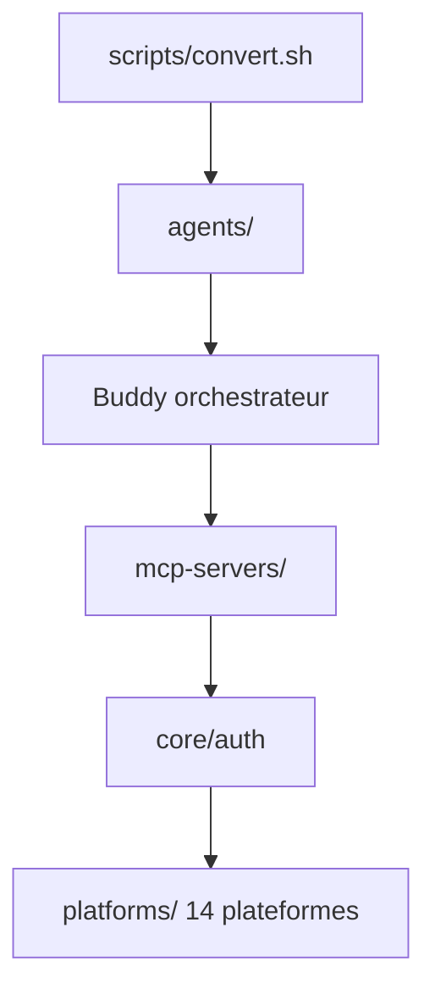

# itallstartedwithaidea/advertising-hub

> Collection d'agents IA, de serveurs MCP et d'utilitaires pour piloter les API publicitaires de quatorze plateformes.

## Le problème
Les API publicitaires (Google, Meta, Microsoft, Amazon...) sont dispersées, et aucun outil ne relie agents, authentification et modèles de données entre elles.

## Ce que ça fait vraiment
Rassemble plus de vingt-cinq spécifications d'agents (stratège PPC, auditeur, analyste d'attribution, répartiteur de budget), un registre de serveurs MCP et un paquet `core/` (authentification, modèles normalisés, limitation de débit, erreurs). Seul le MCP Google Ads est annoncé comme en service ; les autres sont des spécifications ou prévus. Des scripts génèrent des intégrations pour Cursor, Gemini CLI ou Windsurf.

## Comment c'est branché


## Essayer
```bash
cp -r agents/ ~/.claude/agents/advertising-hub/
./scripts/convert.sh
./scripts/install.sh
```

## Coût et pièges
Chaque plateforme publicitaire exige un compte et des identifiants d'API ; les appels agissent sur de vraies dépenses publicitaires. Le README ne dit rien d'une télémétrie.

## Ce que ce n'est pas
Ce n'est pas un produit prêt à l'emploi : la plupart des serveurs MCP ne sont pas écrits. Ce n'est pas un outil de data science.

## Alternatives
- google-ads-mcp : serveur MCP Google Ads en service, cité dans le README.
- The Agency : fondation des agents.

## Pour toi
À surveiller : intéressant si tu automatises des campagnes publicitaires avec des agents, mais un seul serveur est réel et le projet repose sur une personne.

