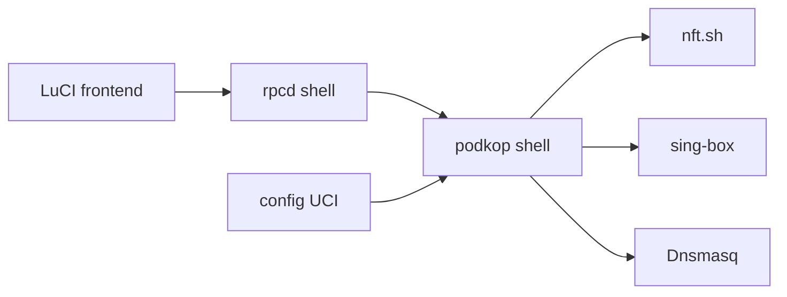

# itdoginfo/podkop

> OpenWrt package for selective traffic routing through a tunnel, based on sing-box.

## The problem
Sending some destinations through a tunnel and the rest directly, from the router.

## What it actually does
An OpenWrt shell service generates the sing-box configuration and manipulates nftables, rule sets and Dnsmasq, with UCI configuration. A TypeScript LuCI interface offers a dashboard and diagnostics (DNS, FakeIP, nftables, sing-box). The dashboard goes through sing-box's Clash API, HTTP only.

## How it is wired


## Trying it
```bash
sh <(wget -O - https://raw.githubusercontent.com/itdoginfo/podkop/refs/heads/main/install.sh)
```

## Cost and gotchas
Free. OpenWrt 24.10 or later, 25 MB free (16 MB flash not supported). Modifies Dnsmasq and sing-box at runtime. Beta, PRs accepted after agreement on Telegram. README in Russian.

## What it is not
Not a turnkey VPN: you must provide the tunnel. Not a tool outside OpenWrt.

## Alternatives
The README mentions Getdomains, to be uninstalled first.

## For you
Ignore: home network routing on a router, unrelated to your data, AI or MLOps work.
