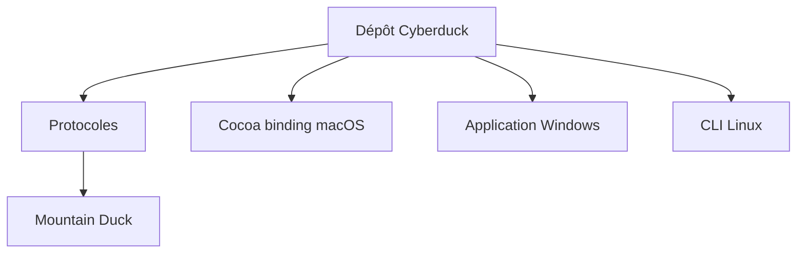

# iterate-ch/cyberduck

> Free file transfer client for macOS and Windows, with a CLI for Linux.

## The problem
Talking to a variety of file servers and storage backends (FTP, cloud) with a single graphical client instead of one tool per protocol.

## What it actually does
Development repository of Cyberduck: a transfer application for macOS and Windows, a CLI on Linux, macOS and Windows. The core libraries are also used by Mountain Duck. The README mostly details the build: Java, Maven, Ant, Xcode or Visual Studio, and Maven artifacts published on S3.

## How it is wired
Simplified diagram based on the sheet, no diagram provided.


## Trying it
```bash
SKIP_SIGN=true mvn verify -DskipTests
mvn verify -Dconfiguration=debug
mvn test -DskipITs
```

## Cost and gotchas
Heavy build: JDK, Maven, Ant, Xcode or Visual Studio 2022, a GitHub token for NuGet on Windows. The README admits that installation via Chocolatey may fail.

## What it is not
Not a data or AI tool. The README does not describe end use of the client, only its development.

## Alternatives
No alternative named in the README.

## For you
Ignore: a general-purpose file transfer client, unrelated to data, AI or MLOps work.
