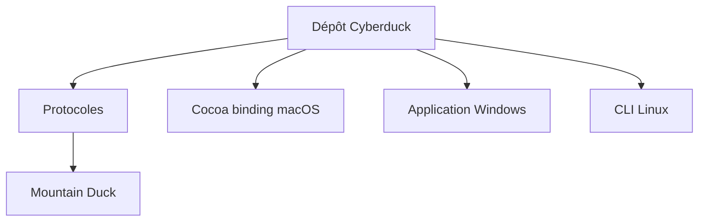

# iterate-ch/cyberduck

> Client de transfert de fichiers libre pour macOS et Windows, avec une CLI pour Linux.

## Le problème
Parler à des serveurs de fichiers et stockages variés (FTP, cloud) avec un seul client graphique au lieu d'un outil par protocole.

## Ce que ça fait vraiment
Dépôt de développement de Cyberduck : application de transfert pour macOS et Windows, CLI sur Linux, macOS et Windows. Les bibliothèques de base servent aussi à Mountain Duck. Le README détaille surtout la construction : Java, Maven, Ant, Xcode ou Visual Studio, et des artefacts Maven publiés sur S3.

## Comment c'est branché
Schéma simplifié d'après la fiche, sans diagramme fourni.


## Essayer
```bash
SKIP_SIGN=true mvn verify -DskipTests
mvn verify -Dconfiguration=debug
mvn test -DskipITs
```

## Coût et pièges
Construction lourde : JDK, Maven, Ant, Xcode ou Visual Studio 2022, jeton GitHub pour NuGet sous Windows. Le README admet que l'installation via Chocolatey peut échouer.

## Ce que ce n'est pas
Pas un outil de données ni d'IA. Le README ne décrit pas l'usage final du client, seulement son développement.

## Alternatives
Aucune alternative nommée dans le README.

## Pour toi
Ignorer : un client de transfert de fichiers généraliste, sans lien avec un travail data, IA ou MLOps.

