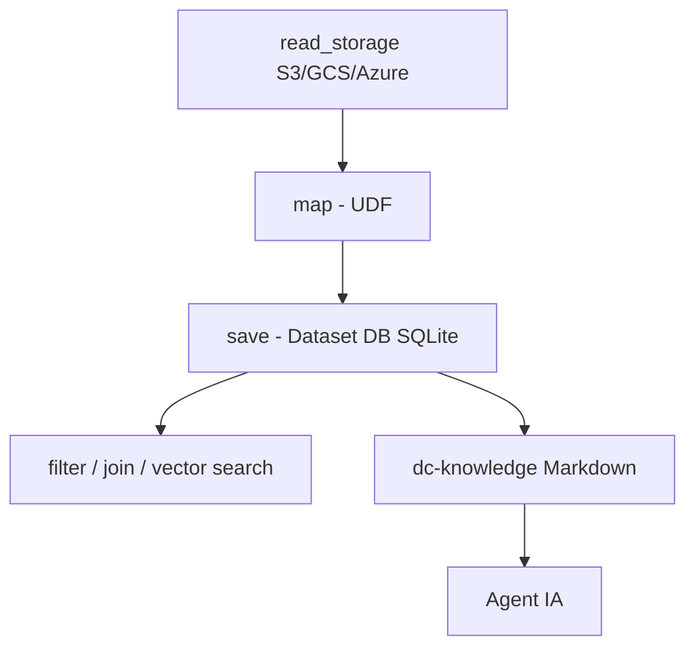

# iterative/datachain

> Python library that turns S3, GCS or Azure files into typed, versioned datasets.

## The problem
Unstructured data (images, files) sits in buckets with no schema and no versioning, and every pipeline recomputes everything.

## What it actually does
Indexes storage into versioned Pydantic datasets (file pointers, no copy), stored locally in SQLite (`.datachain/db`). Vectorized filters, joins and aggregations without downloading the files; vector search on the same rows; resume from checkpoints after a crash; incremental updates. A Markdown "Knowledge Base" layer and a skill for Claude Code, Cursor, Codex, Copilot and Pi are optional. Studio (a service) adds a shared registry and distributed compute.

## How it is wired


## Trying it
```bash
pip install datachain
datachain skill install --target claude
datachain cp --anon s3://dc-readme/fiona.jpg .
```

## Cost and gotchas
Free locally; Studio (account, `datachain auth login`) is a separate service. Agent usage assumes your own agent subscription/key.

## What it is not
Not a data warehouse nor storage: the bytes stay in your buckets.

## Alternatives
No alternative named in the README (pandas is cited as limited by RAM).

## For you
Adopt as a trial: directly addresses the need to version and query image or document datasets for AI, locally before any Studio.
