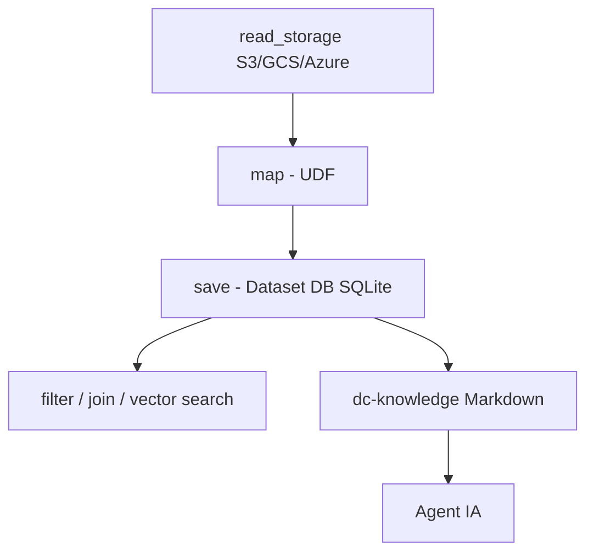

# iterative/datachain

> Bibliothèque Python qui transforme des fichiers S3, GCS ou Azure en jeux de données typés et versionnés.

## Le problème
Les données non structurées (images, fichiers) restent dans des buckets sans schéma, sans version, et chaque pipeline recalcule tout.

## Ce que ça fait vraiment
Indexe le stockage en jeux de données Pydantic versionnés (pointeurs de fichiers, pas de copie), stockés localement dans SQLite (`.datachain/db`). Filtres, jointures et agrégations vectorisés sans télécharger les fichiers ; recherche vectorielle sur les mêmes lignes ; reprise par checkpoints après plantage ; mises à jour incrémentales. Une couche « Knowledge Base » en Markdown et un skill pour Claude Code, Cursor, Codex, Copilot et Pi sont optionnels. Studio (service) ajoute registre partagé et calcul distribué.

## Comment c'est branché


## Essayer
```bash
pip install datachain
datachain skill install --target claude
datachain cp --anon s3://dc-readme/fiona.jpg .
```

## Coût et pièges
Gratuit en local ; Studio (compte, `datachain auth login`) est un service distinct. L'usage agent suppose ton propre abonnement/clé d'agent.

## Ce que ce n'est pas
Pas un entrepôt de données ni un stockage : les octets restent dans tes buckets.

## Alternatives
Aucune alternative nommée dans le README (pandas est cité comme limité par la RAM).

## Pour toi
À adopter à l'essai : répond directement au besoin de versionner et d'interroger des jeux d'images ou de documents pour de l'IA, en local avant tout Studio.

