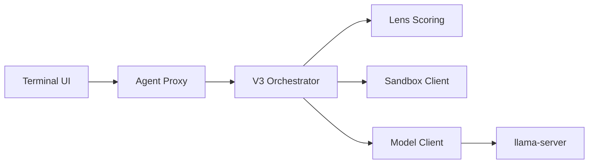

# itigges22/ATLAS

> Local coding agent that adds planning, sandboxed verification and repair around small models.

## The problem
Small local models produce less reliable code than hosted models, with no verification or repair.

## What it actually does
A TUI (Bubbletea) and a Go proxy orchestrate a V3 pipeline: planning (PlanSearch), varied candidates, thinking budget, auto-generated tests, refinement loops in a sandbox (Python, Rust, Go, C...). A "Geometric Lens" scores candidates from the model's embeddings (MLP and XGBoost). Inference goes through llama-server on GGUF, with grammar-constrained decoding. 74.6% score on LiveCodeBench for a frozen 14B model (author's measurement).

## How it is wired


## Trying it
```bash
curl -fsSL https://raw.githubusercontent.com/itigges22/ATLAS/main/scripts/atlas-bootstrap.sh | bash
atlas
```

## Cost and gotchas
16 GB of VRAM minimum, Docker, about 20 GB of disk, 10 to 30 minutes of installation. Sandbox commands have outbound network access by default. Constrained decoding is slow (~51 tok/s).

## What it is not
Not yet benchmarked on the registry's current models; complex feature additions remain uneven. AGPL-3.0 license: sharing obligations when exposed over a network.

## Alternatives
- No alternative named in the README.

## For you
Worth watching: an interesting idea for 100% local coding on a 16 GB GPU, but AGPL, young and little validated.
