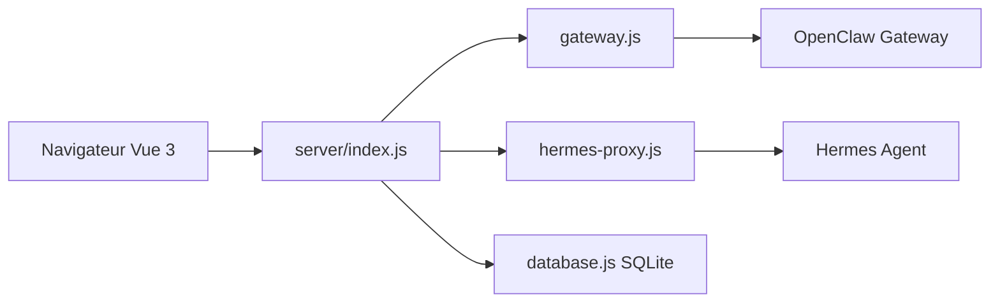

# itq5/OpenClaw-Admin

> Vue 3 web console for administering AI agents on the OpenClaw Gateway and Hermes Agent gateways.

## The problem
Managing sessions, models, channels, scheduled tasks and memory of AI agents from the command line is impractical.

## What it actually does
Vue 3 and Express dashboard with chat, sessions, models, channels (QQ, Feishu, DingTalk, WeCom, Telegram, Discord, Slack), skills and cron. It also offers a web terminal (xterm.js, node-pty), a remote desktop, a file explorer and system monitoring. It talks to OpenClaw over WebSocket RPC and to Hermes through a REST proxy.

## How it is wired


## Trying it
```bash
npm install
cp .env.example .env
npm run dev:all
npm run build
npm run start
```

## Cost and gotchas
Node 18 or later; Python 3.10 or later for the Hermes terminal. It must run on the gateway node (127.0.0.1 or localhost only). The example `.env` uses admin/admin and a token 1212: change them. Model keys remain at your expense.

## What it is not
Not an agent gateway: it depends on them. The terminal and remote desktop expose a takeover of the machine: do not open it to the Internet. README in Chinese.

## Alternatives
No alternative named in the README.

## For you
Ignore unless you already run OpenClaw or Hermes: the tool is young, depends on them and exposes terminal access.
