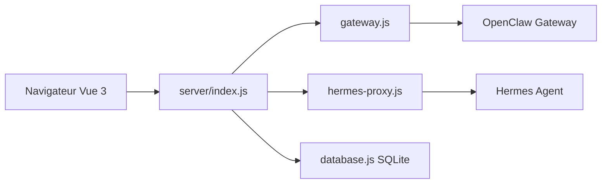

# itq5/OpenClaw-Admin

> Console web Vue 3 pour administrer des agents IA sur les passerelles OpenClaw Gateway et Hermes Agent.

## Le problème
Gérer sessions, modèles, canaux, tâches planifiées et mémoire d'agents IA en ligne de commande est peu pratique.

## Ce que ça fait vraiment
Tableau de bord Vue 3 et Express avec chat, sessions, modèles, canaux (QQ, Feishu, DingTalk, WeCom, Telegram, Discord, Slack), compétences et cron. Il propose aussi un terminal web (xterm.js, node-pty), un bureau distant, un explorateur de fichiers et la supervision système. Parle à OpenClaw par WebSocket RPC et à Hermes par proxy REST.

## Comment c'est branché


## Essayer
```bash
npm install
cp .env.example .env
npm run dev:all
npm run build
npm run start
```

## Coût et pièges
Node 18 ou plus ; Python 3.10 ou plus pour le terminal Hermes. Il doit tourner sur le nœud de la passerelle (127.0.0.1 ou localhost uniquement). L'exemple de `.env` utilise admin/admin et un jeton 1212 : à changer. Les clés de modèles restent à ta charge.

## Ce que ce n'est pas
Pas une passerelle d'agents : il en dépend. Le terminal et le bureau distant exposent une prise de contrôle de machine : ne pas l'ouvrir sur Internet. README en chinois.

## Alternatives
Aucune alternative nommée dans le README.

## Pour toi
À ignorer sauf si tu exploites déjà OpenClaw ou Hermes : l'outil est jeune, dépend d'eux et expose un accès terminal.

