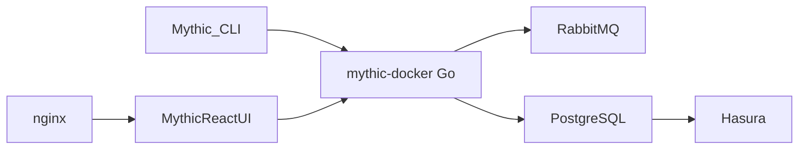

# its-a-feature/Mythic

> Collaborative red teaming platform, for security teams operating under an authorized assessment mandate.

## The problem
Red teams run multi-operator exercises and need to coordinate, track and report their actions in a single tool.

## What it actually does
A Go server orchestrated by docker-compose, React web interface, RabbitMQ messaging, PostgreSQL and GraphQL via Hasura, with Grafana and Prometheus. The repository hosts no agent or communication profile: they are installed from other GitHub repositories via `mythic-cli`. The README specifies authorized use, to assess security posture and for research.

## How it is wired


## Trying it
```bash
sudo make
sudo ./mythic-cli start
sudo ./mythic-cli update
```

## Cost and gotchas
Free; requires Docker and root rights. License present but not identified by GitHub: read it before any use. Legal use only within a contractual assessment framework.

## What it is not
Not a defensive security or MLOps tool. The core alone does nothing without external modules installed separately.

## Alternatives
No alternative named in the README.

## For you
Ignore: outside the data/AI/MLOps scope, and reserved for mandated offensive teams; license to be clarified.
