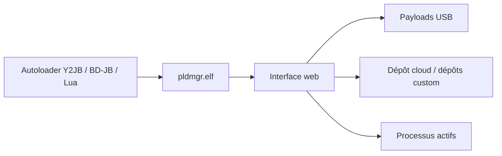

# itsPLK/ps5-payload-manager

> Web-based payload manager for an already-jailbroken PS5, aimed at console homebrew fans.

## The problem
Loading `.elf` payloads by hand onto a jailbroken PS5 is tedious: you have to copy them, relaunch them and track the processes.

## What it actually does
Provides a web dashboard, usable from a PC, a phone or the PS5, to import payloads (USB stick or cloud repository), define an automatic startup list, manage favorites and inspect or terminate processes. Installs an icon on the home screen. Accepts third-party repositories through a JSON (separate guide) and several languages.

## How it is wired


## Trying it
```bash
# Recommandé : utiliser un autoloader ; pldmgr.elf est inclus par défaut dans les versions récentes
# Ancien autoloader : placer pldmgr.elf dans le dossier autoload
#   puis en faire la seule entrée de autoload.txt
# Sinon : charger le .elf téléchargé depuis les Releases comme n'importe quel payload
```

## Cost and gotchas
Free, but assumes a console that is already jailbroken: the exploit and autoloader are outside the repo. Third-party payload repositories come from sources you must judge yourself.

## What it is not
It is not a jailbreak tool: it does not unlock anything. No relation to data/AI work. The README does not document the build commands (it refers to DEVELOPMENT.md).

## Alternatives
No alternative named in the README (it relies on John Törnblom's PS5 Payload SDK).

## For you
Ignore: a console homebrew tool with no link to a data, AI or MLOps profile, and reserved for an already-jailbroken machine.
