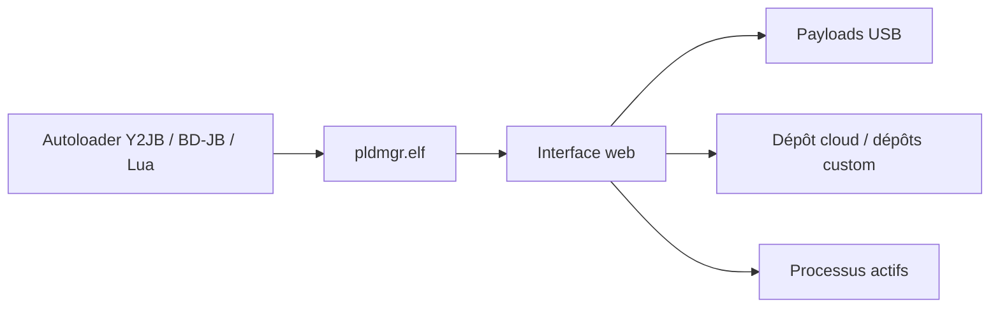

# itsPLK/ps5-payload-manager

> Gestionnaire web de payloads pour PS5 déjà débridée, destiné aux adeptes du homebrew console.

## Le problème
Charger des payloads `.elf` à la main sur une PS5 débridée est fastidieux : il faut les copier, les relancer et suivre les processus.

## Ce que ça fait vraiment
Fournit un tableau de bord web, utilisable depuis un PC, un téléphone ou la PS5, pour importer des payloads (clé USB ou dépôt cloud), définir une liste de démarrage automatique, gérer des favoris et inspecter ou terminer des processus. Installe une icône sur l'écran d'accueil. Accepte des dépôts tiers via un JSON (guide à part) et plusieurs langues.

## Comment c'est branché


## Essayer
```bash
# Recommandé : utiliser un autoloader ; pldmgr.elf est inclus par défaut dans les versions récentes
# Ancien autoloader : placer pldmgr.elf dans le dossier autoload
#   puis en faire la seule entrée de autoload.txt
# Sinon : charger le .elf téléchargé depuis les Releases comme n'importe quel payload
```

## Coût et pièges
Gratuit, mais suppose une console déjà jailbreakée : exploit et autoloader sont hors du dépôt. Les dépôts de payloads tiers viennent de sources que tu dois juger toi-même.

## Ce que ce n'est pas
Ce n'est pas un outil de jailbreak : il ne débride rien. Aucun rapport avec le travail data/IA. Le README ne documente pas les commandes de build (renvoi à DEVELOPMENT.md).

## Alternatives
Aucune alternative nommée dans le README (il s'appuie sur le PS5 Payload SDK de John Törnblom).

## Pour toi
À ignorer : outil de homebrew console sans lien avec un profil data, IA ou MLOps, et réservé à une machine déjà débridée.

