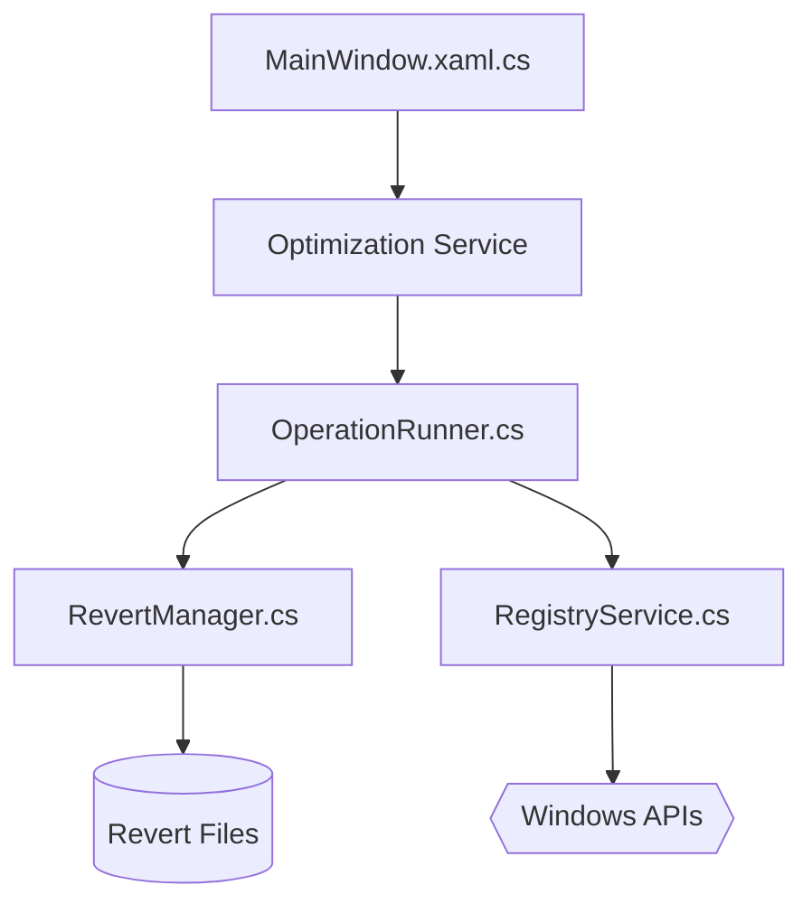

# itsfatduck/optimizerDuck

> Free Windows tool that applies performance and privacy tweaks, with rollback.

## The problem
Windows ships with services, telemetry, preinstalled apps and scheduled tasks running in the background. Useful settings are scattered across the registry, group policies and PowerShell.

## What it actually does
Offers 42 tweaks in 7 categories (performance, privacy, GPU, power, bloatware and services, experience, AI) with a risk level, plus 44 customization tweaks. Includes a system dashboard, a startup manager, scheduled tasks, disk cleanup and bloatware removal. Every change writes a local rollback file.

## How it is wired


## Trying it
The README only documents downloading the `.exe` from the Releases (no installation); from source:
```bash
dotnet build
```

## Cost and gotchas
Free. Administrator rights required, Windows 10/11 only. Unsigned binary: SmartScreen warns about it. Create a restore point before use. License: the catalog does not identify it, the README cites GPL v3 (copyleft), to be checked.

## What it is not
Not a guaranteed FPS gain: the README itself says it will not double anything. It modifies the registry: "at your own risk" (disclaimer). Not cross-platform.

## Alternatives
No alternative named in the README (it only mentions "well-known tools" without names).

## For you
Ignore: consumer Windows tuning tool, unrelated to data/AI/MLOps; and a tool that writes to the registry without a clearly identified license.
