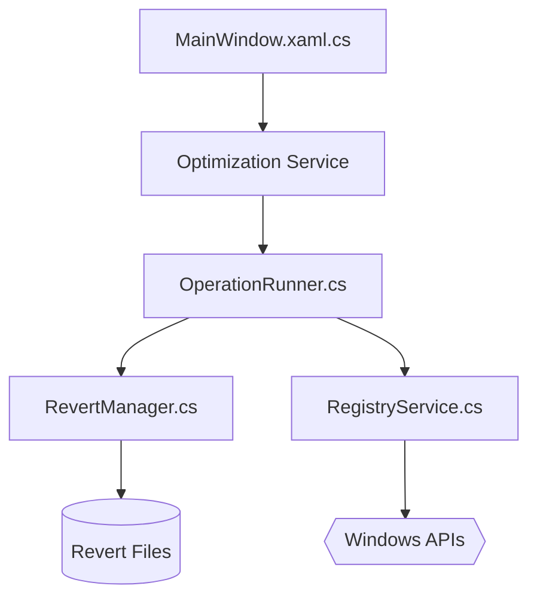

# itsfatduck/optimizerDuck

> Outil Windows gratuit qui applique des réglages de performance et de confidentialité, avec retour arrière.

## Le problème
Windows embarque services, télémétrie, applis préinstallées et tâches planifiées actifs en fond. Les réglages utiles sont éparpillés entre registre, stratégies de groupe et PowerShell.

## Ce que ça fait vraiment
Propose 42 réglages en 7 catégories (performance, vie privée, GPU, alimentation, bloatware et services, expérience, IA) avec un niveau de risque, plus 44 réglages de personnalisation. Embarque un tableau de bord système, un gestionnaire de démarrage, des tâches planifiées, un nettoyage disque et un retrait de bloatware. Chaque changement écrit un fichier de retour arrière local.

## Comment c'est branché


## Essayer
Le README ne documente que le téléchargement du `.exe` depuis les Releases (aucune installation) ; côté source :
```bash
dotnet build
```

## Coût et pièges
Gratuit. Droits administrateur obligatoires, Windows 10/11 seulement. Binaire non signé : SmartScreen l'avertit. Crée un point de restauration avant usage. Licence : le catalogue ne l'identifie pas, le README cite GPL v3 (copyleft), à vérifier.

## Ce que ce n'est pas
Pas un gain de FPS garanti : le README dit lui-même qu'il ne doublera rien. Modifie le registre : « à tes risques » (clause de non-responsabilité). Pas multi-plateforme.

## Alternatives
Aucune alternative nommée dans le README (il cite seulement « des outils connus » sans noms).

## Pour toi
Ignorer : outil de tuning Windows grand public, sans lien avec data/IA/MLOps ; et un outil qui écrit dans le registre sans licence clairement identifiée.

