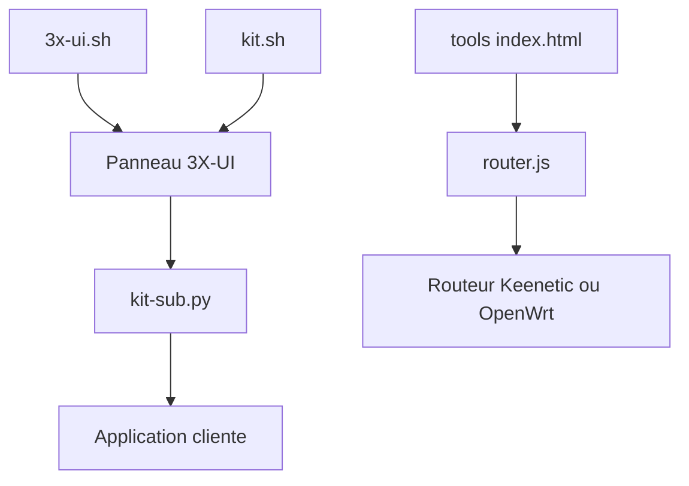

# itsnotkubrick/3X-UI_KIT

> Install scripts for 3X-UI on a VPS with up to 11 VPN protocols and a single subscription.

## The problem
Setting up a multi-protocol VPN server by hand requires configuring the panel, certificates, firewall and subscriptions.

## What it actually does
A script installs the 3X-UI panel and the protocols (VLESS REALITY, Trojan, Hysteria2, AmneziaWG, etc.) on port 443, and produces one subscription link per application. The `kit` command handles users, backups and diagnostics. Web generators create Xray or Mihomo configs for routers.

## How it is wired


## Trying it
```bash
bash <(curl -fsSL https://raw.githubusercontent.com/itsnotkubrick/3X-UI_KIT/v1.2.1/scripts/3x-ui.sh)
```

## Cost and gotchas
Free, but you must rent a VPS running Ubuntu 22.04/24.04 or Debian 12/13 with root access. README is in Russian. The author includes a hosting referral link; use remains your own legal responsibility.

## What it is not
Not a VPN service provided to you: you host it yourself. The repository states that it gives no access to any server.

## Alternatives
3X-UI, on which it builds, and XKeen for the router.

## For you
Ignore: VPN administration, unrelated to data, AI or MLOps work.
