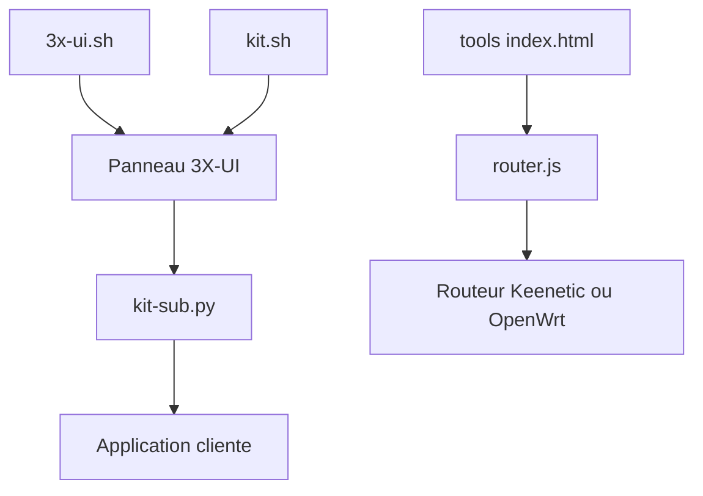

# itsnotkubrick/3X-UI_KIT

> Scripts d'installation de 3X-UI sur un VPS avec jusqu'à 11 protocoles VPN et une seule souscription.

## Le problème
Monter un serveur VPN multi-protocoles à la main demande de configurer panneau, certificats, pare-feu et abonnements.

## Ce que ça fait vraiment
Un script installe le panneau 3X-UI, les protocoles (VLESS REALITY, Trojan, Hysteria2, AmneziaWG, etc.) sur le port 443, et produit un lien d'abonnement par application. La commande `kit` gère utilisateurs, sauvegardes et diagnostics. Des générateurs web créent des configs Xray ou Mihomo pour routeurs.

## Comment c'est branché


## Essayer
```bash
bash <(curl -fsSL https://raw.githubusercontent.com/itsnotkubrick/3X-UI_KIT/v1.2.1/scripts/3x-ui.sh)
```

## Coût et pièges
Gratuit, mais il faut louer un VPS Ubuntu 22.04/24.04 ou Debian 12/13 avec accès root. README en russe. L'auteur met un lien de parrainage d'hébergeur ; l'usage reste sous ta responsabilité légale.

## Ce que ce n'est pas
Pas un service VPN fourni : tu t'héberges toi-même. Le dépôt précise qu'il ne donne accès à aucun serveur.

## Alternatives
3X-UI, sur lequel il s'appuie, et XKeen pour le routeur.

## Pour toi
À ignorer : administration VPN, sans lien avec un travail data, IA ou MLOps.

