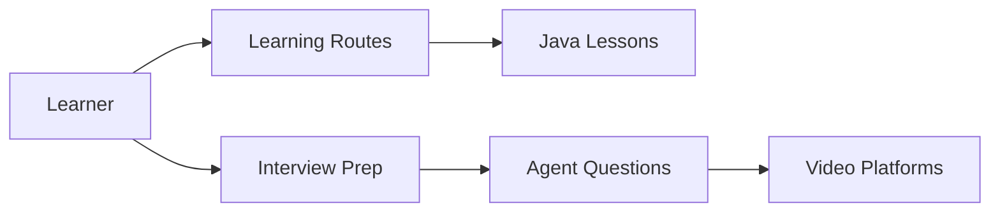

# itwanger/toBeBetterJavaer

> Chinese knowledge base on Java, job interviews and AI agent questions.

## The problem
A Java beginner looks for a structured path, study materials and interview preparation.

## What it actually does
README in Chinese serving as a table of contents: Java (syntax, collections, IO, concurrency, JVM), Spring Boot, MySQL, Redis, computing basics, "面渣逆袭" (interview questions), learning paths and PDFs. New section: 369 questions on AI agents (RAG, MCP, memory, KV cache), pointing to the `itwanger/ai-better` repository. VuePress site; promotion of a paid group and a donation account. The repository also contains a Remotion example.

## How it is wired


## Trying it
```bash
pnpm docs:clean-dev
cp .env.example .env
./deploy-docs.sh
```

## Cost and gotchas
Reading is free; the side content (courses, PDFs) leads to paid offers. No license declared, and the author forbids reproduction.

## What it is not
Not an AI course: the agents part is a list of questions pointing elsewhere. Link not verified here.

## Alternatives
JavaGuide, paicoding, Hippo4J ("friend links" of the README).

## For you
In Chinese and Java-oriented: of little use to a French-speaking data/AI profile; ignore.
