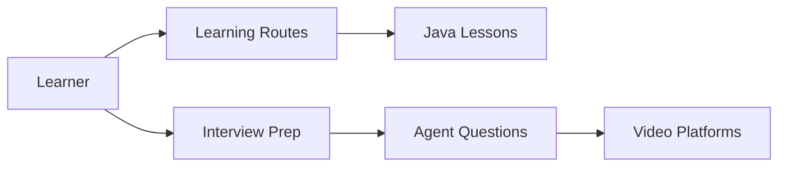

# itwanger/toBeBetterJavaer

> Base de connaissances chinoise sur Java, entretiens d'embauche et questions sur les agents IA.

## Le problème
Un débutant en Java cherche un parcours structuré, des supports d'étude et une préparation aux entretiens.

## Ce que ça fait vraiment
README en chinois servant de sommaire : Java (syntaxe, collections, IO, concurrence, JVM), Spring Boot, MySQL, Redis, calculs de base, « 面渣逆袭 » (questions d'entretien), parcours d'apprentissage et PDF. Nouvelle section : 369 questions sur les agents IA (RAG, MCP, mémoire, KV cache), renvoyées au dépôt `itwanger/ai-better`. Site VuePress ; promotion d'un groupe payant et d'un compte de dons. Le dépôt contient aussi un exemple Remotion.

## Comment c'est branché


## Essayer
```bash
pnpm docs:clean-dev
cp .env.example .env
./deploy-docs.sh
```

## Coût et pièges
Lecture gratuite ; les contenus annexes (cours, PDF) mènent à des offres payantes. Aucune licence déclarée, et l'auteur interdit la reproduction.

## Ce que ce n'est pas
Pas un cours sur l'IA : la partie agents est une liste de questions renvoyée ailleurs. Lien non vérifié ici.

## Alternatives
JavaGuide, paicoding, Hippo4J (« liens amis » du README).

## Pour toi
En chinois et orienté Java : peu utile à un profil data/IA francophone ; à ignorer.

