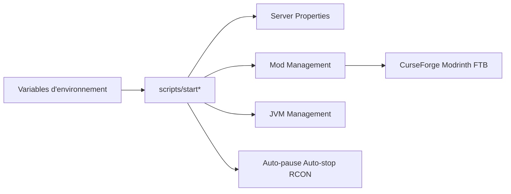

# itzg/docker-minecraft-server

> Configurable Docker image to host a Minecraft Java server with mods and plugins.

## The problem
Installing, updating and configuring a Minecraft server by hand.

## What it actually does
Startup scripts read environment variables, install the chosen version and server type, generate the properties, manage mods and plugins (CurseForge, Modrinth, FTB, Spiget, Vanilla Tweaks), RCON, health check, auto-pause and auto-stop. README truncated: links and headings are missing, details not documented here.

## How it is wired

## Trying it
No command in the provided README: it points to a Docker Compose quick start and to the `examples` folder.

## Cost and gotchas
Free; Docker and memory for the server. Java edition only; Bedrock needs another image.

## What it is not
Not a hosting provider or an administration panel.

## Alternatives
itzg/minecraft-bedrock-server for the Bedrock edition.

## For you
Ignore: unrelated to data/AI, except as an example of an environment-driven Docker image.
