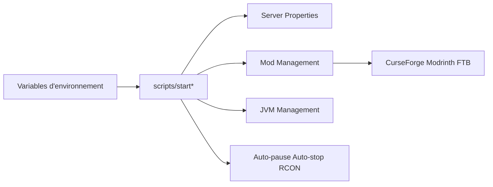

# itzg/docker-minecraft-server

> Image Docker configurable pour héberger un serveur Minecraft Java avec mods et plugins.

## Le problème
Installer, mettre à jour et configurer un serveur Minecraft à la main.

## Ce que ça fait vraiment
Des scripts de démarrage lisent des variables d'environnement, installent la version choisie et le type de serveur, génèrent les propriétés, gèrent mods et plugins (CurseForge, Modrinth, FTB, Spiget, Vanilla Tweaks), RCON, vérification de santé, auto-pause et auto-arrêt. README tronqué : liens et en-têtes manquent, détails non documentés ici.

## Comment c'est branché

## Essayer
Aucune commande dans le README fourni : il renvoie à un démarrage rapide Docker Compose et au dossier `examples`.

## Coût et pièges
Gratuit ; Docker et mémoire pour le serveur. Édition Java uniquement ; Bedrock demande une autre image.

## Ce que ce n'est pas
Pas un hébergeur ni un panneau d'administration.

## Alternatives
itzg/minecraft-bedrock-server pour l'édition Bedrock.

## Pour toi
Ignorer : sans rapport avec data/IA, sauf comme exemple d'image Docker pilotée par environnement.

