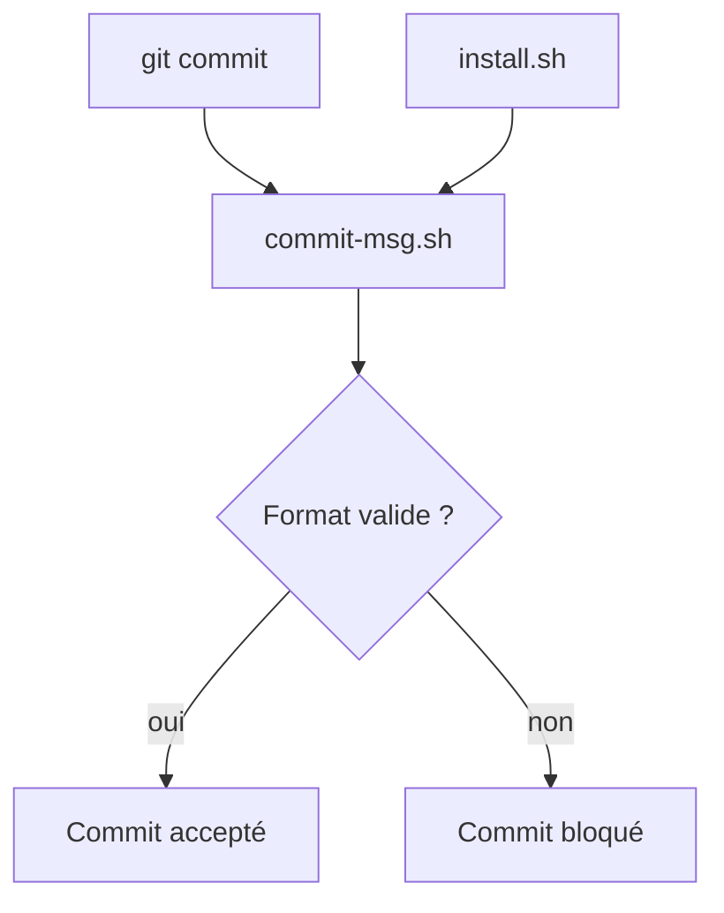

# iuricode/padroes-de-commits

> A Portuguese-language guide to semantic commit messages with emojis, and a Git hook to validate them.

## The problem
Free-form commit messages make the history unreadable and block automated tools.

## What it actually does
Describes the `:emoji: type(scope): description` format based on Conventional Commits, with the types (feat, fix, docs, security…) and an emoji table. Provides a `commit-msg.sh` hook that blocks messages outside the format, an `install.sh`, a pre-commit hook, and an interactive `push.sh`. `prepare-commit-msg.sh` (AI-based suggestion) is experimental.

## How it is wired
Simplified diagram based on the sheet, no diagram provided.



## Trying it
```bash
git clone https://github.com/iuricode/padroes-de-commits.git
./padroes-de-commits/install.sh caminho/do/seu-projeto
git commit --allow-empty -m "mensagem fora do padrão"
pre-commit install --hook-type commit-msg
```

## Cost and gotchas
Free. Bash required (Git Bash on Windows), missing from the listed prerequisites. A global `core.hooksPath` makes each repository's hooks be ignored. The AI script requires a local service.

## What it is not
Not a changelog generator. Documentation is in Portuguese.

## Alternatives
Conventional Commits, which the README draws on.

## For you
Keep an eye on it: a simple hook to enforce clean commits in an MLOps team, with no effect on the quality of the code itself.
