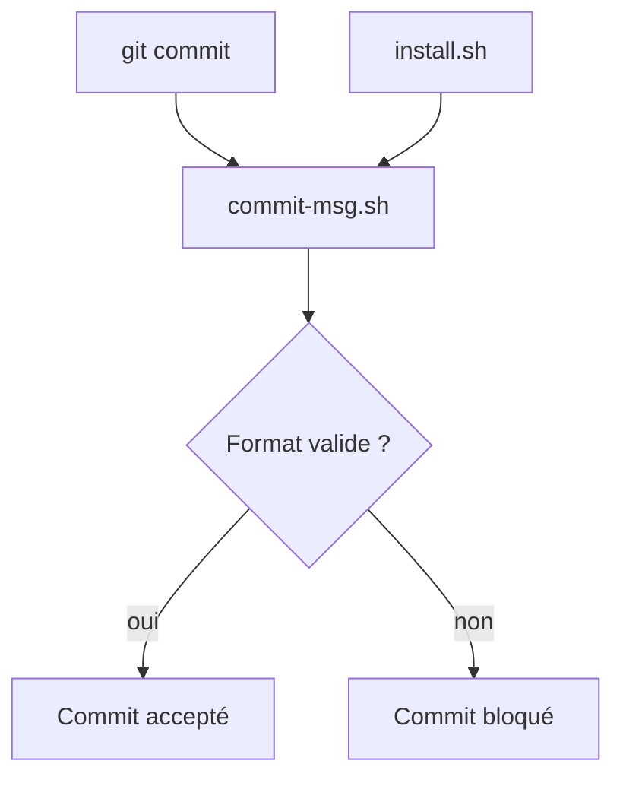

# iuricode/padroes-de-commits

> Guide en portugais des messages de commit sémantiques avec emojis, et hook Git pour les valider.

## Le problème
Des messages de commit libres rendent l'historique illisible et bloquent les outils automatiques.

## Ce que ça fait vraiment
Décrit le format `:emoji: type(scope): description` basé sur Conventional Commits, avec les types (feat, fix, docs, security…) et une table d'emojis. Fournit un hook `commit-msg.sh` qui bloque les messages hors format, un `install.sh`, un hook pre-commit, et un `push.sh` interactif. `prepare-commit-msg.sh` (suggestion par IA) est expérimental.

## Comment c'est branché
Schéma simplifié d'après la fiche, sans diagramme fourni.



## Essayer
```bash
git clone https://github.com/iuricode/padroes-de-commits.git
./padroes-de-commits/install.sh caminho/do/seu-projeto
git commit --allow-empty -m "mensagem fora do padrão"
pre-commit install --hook-type commit-msg
```

## Coût et pièges
Gratuit. Bash requis (Git Bash sous Windows), absent des prérequis listés. Un `core.hooksPath` global fait ignorer les hooks de chaque dépôt. Le script d'IA exige un service local.

## Ce que ce n'est pas
Pas un générateur de changelog. Documentation en portugais.

## Alternatives
Conventional Commits, dont le README s'inspire.

## Pour toi
À surveiller : hook simple pour imposer des commits propres dans une équipe MLOps, sans effet sur la qualité du code lui-même.

