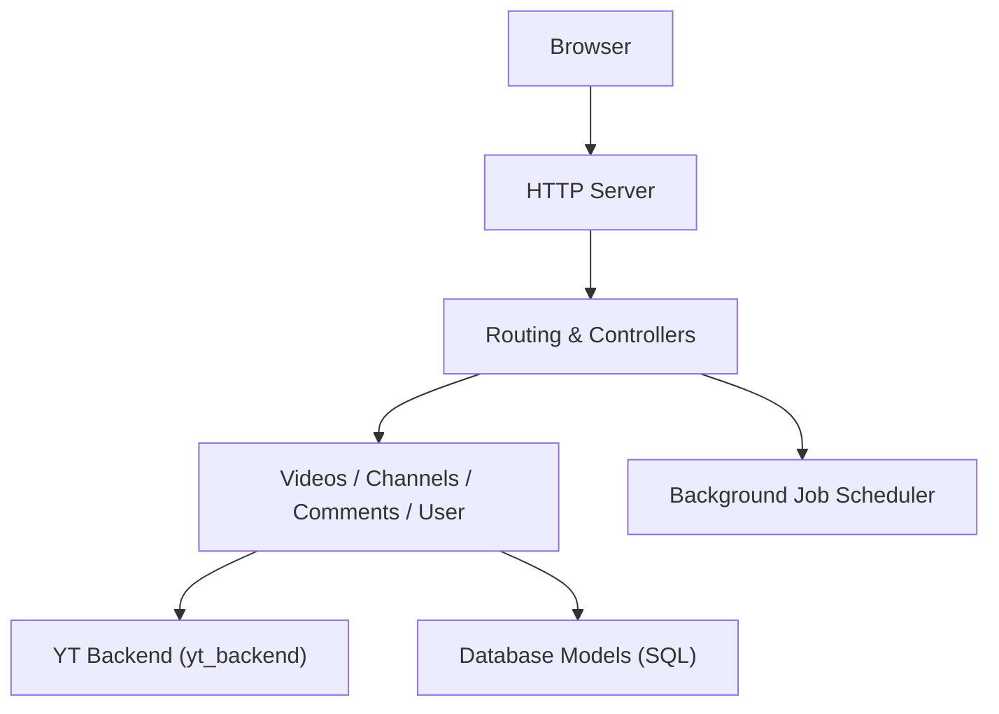

# iv-org/invidious

> Free, self-hostable alternative front end for YouTube, with no ads and no tracking.

## The problem
Watching YouTube means ads, tracking, and JavaScript.

## What it actually does
A web server written in Crystal that fetches YouTube data without going through its official APIs and serves it in a lightweight interface. It handles subscriptions independent of Google, comments, audio mode, import from YouTube, NewPipe and FreeTube, and an API for developers.

## How it is wired

## Trying it
No command in the README: it points to https://docs.invidious.io/ for installation and to a list of public instances.

## Cost and gotchas
Free, but depends on YouTube: a change on YouTube's side can break extraction. Self-hosting: you must provide the database and the server. AGPL-3.0 license, strong copyleft.

## What it is not
Not a download tool (the README disclaims any responsibility for illegal use). Public instances are run by third parties.

## Alternatives
No alternative named in the README, apart from NewPipe and FreeTube cited for import and export.

## For you
Ignore: a personal viewing use, with no value for data, AI, or MLOps work.
