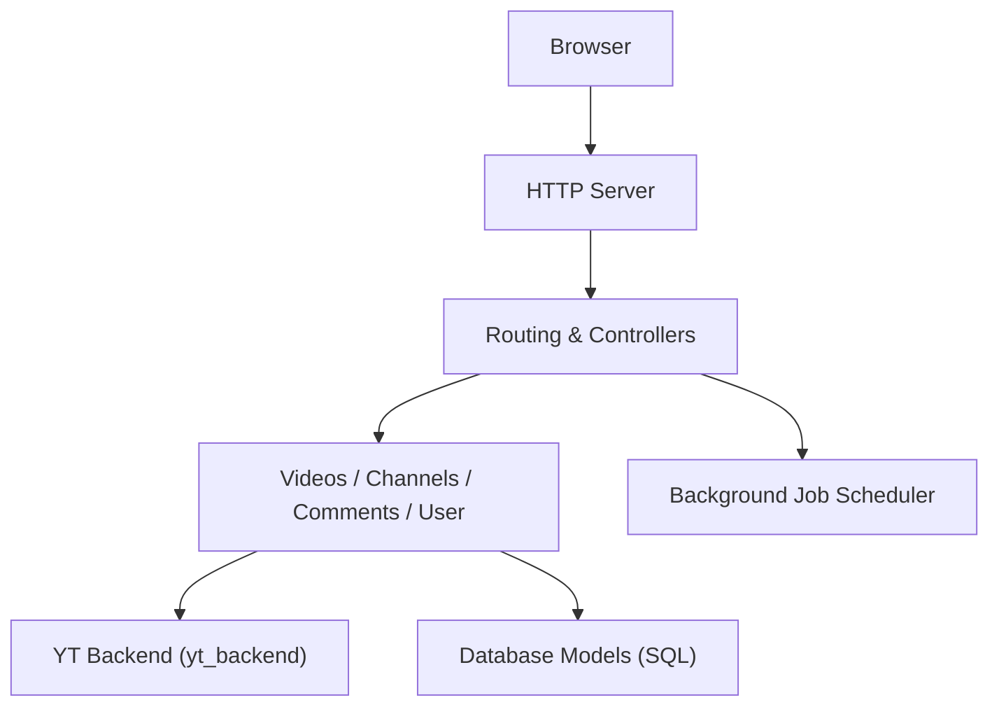

# iv-org/invidious

> Front-end libre alternatif à YouTube, auto-hébergeable, sans publicité ni suivi.

## Le problème
Regarder YouTube impose publicités, pistage et JavaScript.

## Ce que ça fait vraiment
Serveur web en Crystal qui récupère les données de YouTube sans passer par ses API officielles et les sert dans une interface légère. Gère les abonnements indépendants de Google, les commentaires, le mode audio, l'import depuis YouTube, NewPipe et FreeTube, et une API pour développeurs.

## Comment c'est branché

## Essayer
Aucune commande dans le README : il renvoie à https://docs.invidious.io/ pour l'installation et à une liste d'instances publiques.

## Coût et pièges
Gratuit, mais dépend de YouTube : une modification côté YouTube peut casser l'extraction. Auto-hébergement : base de données et serveur à fournir. Licence AGPL-3.0, copyleft fort.

## Ce que ce n'est pas
Pas un outil de téléchargement (le README décline toute responsabilité sur un usage illégal). Les instances publiques sont gérées par des tiers.

## Alternatives
Aucune alternative nommée dans le README, hors NewPipe et FreeTube cités pour l'import et l'export.

## Pour toi
À ignorer : un usage personnel de visionnage, sans valeur pour un travail data, IA ou MLOps.

