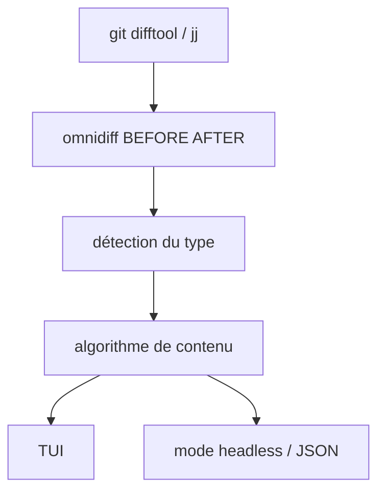

# ivankovic/omnidiff

> Terminal diff tool that compares code, images, fonts, PDFs and archives by their content.

## The problem
A line-by-line diff flags whole lines and says nothing useful about a modified PDF, image or font.

## What it actually does
It diffs according to file type: code via tree-sitter, but also images, cursors, fonts, archives, message catalogs and PDFs. It offers a TUI, a batch mode, JSON output, and integrates with git difftool and jj. The authors measure 98.8% of changes handled by content and perfect precision on 70% of code cases (`--minimal` setting).

## How it is wired
Simplified diagram based on the sheet, no diagram provided.



## Trying it
```bash
cargo install --locked omnidiff
omnidiff BEFORE AFTER
omnidiff --headless BEFORE AFTER
omnidiff git configure
```

## Cost and gotchas
Free. Building from source requires a C compiler and Rust 1.92 or later, and takes a few minutes. Binaries, Homebrew, apt and Nix are available. External contributions are not accepted.

## What it is not
Not a merge tool. `git diff` stays text-only; only `git difftool` opens the TUI. The license is AGPL with a paid commercial version, to be read before any business use. The project itself admits it does not reach its precision goals.

## Alternatives
No alternative named in the README.

## For you
Keep an eye on it: handy for reviewing PDF or image diffs in MLOps, but the AGPL and the single maintainer (code largely written with an AI) call for caution in a company setting.
