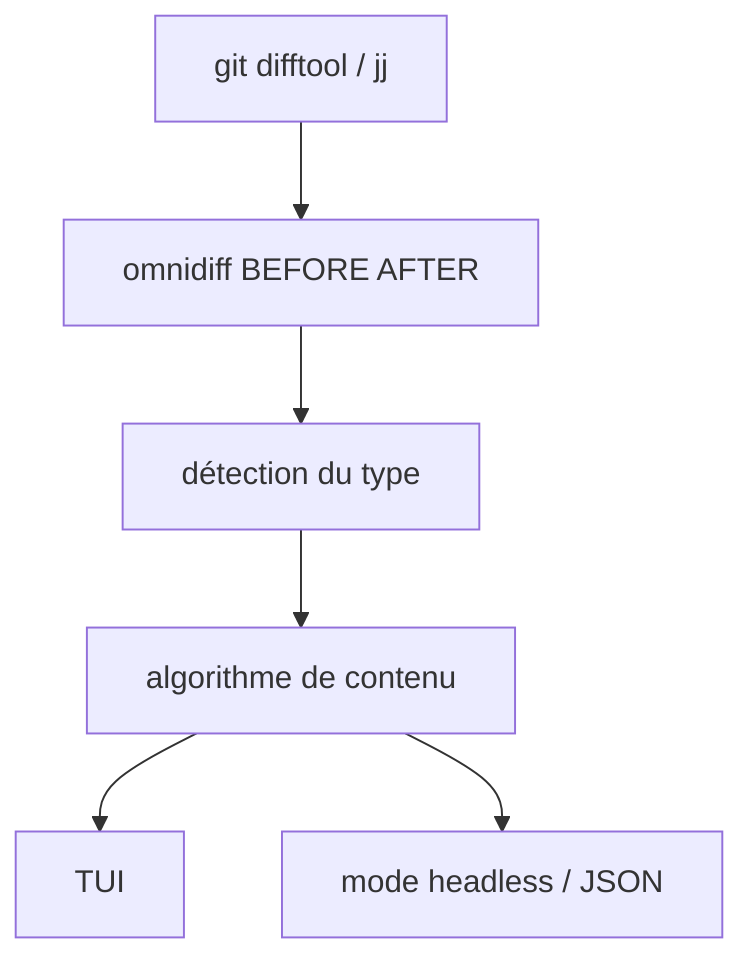

# ivankovic/omnidiff

> Outil de diff en terminal qui compare code, images, polices, PDF et archives selon leur contenu.

## Le problème
Un diff ligne à ligne marque des lignes entières et ne dit rien d'utile sur un PDF, une image ou une police modifiés.

## Ce que ça fait vraiment
Il diffe selon le type de fichier : code via tree-sitter, mais aussi images, curseurs, polices, archives, catalogues de messages et PDF. Il propose une TUI, un mode batch, une sortie JSON et s'intègre à git difftool et jj. Les auteurs mesurent 98,8 % des changements traités par contenu et une précision parfaite sur 70 % des cas de code (réglage `--minimal`).

## Comment c'est branché
Schéma simplifié d'après la fiche, sans diagramme fourni.



## Essayer
```bash
cargo install --locked omnidiff
omnidiff BEFORE AFTER
omnidiff --headless BEFORE AFTER
omnidiff git configure
```

## Coût et pièges
Gratuit. La compilation depuis les sources exige un compilateur C et Rust 1.92 ou plus, et dure quelques minutes. Des binaires, Homebrew, apt et Nix existent. Les contributions externes ne sont pas acceptées.

## Ce que ce n'est pas
Pas un outil de merge. `git diff` reste en texte, seul `git difftool` ouvre la TUI. La licence est AGPL avec une version commerciale payante, à lire avant un usage en entreprise. Le projet reconnaît lui-même ne pas atteindre ses objectifs de précision.

## Alternatives
Aucune alternative nommée dans le README.

## Pour toi
Surveiller : pratique pour relire des diffs de PDF ou d'images en MLOps, mais l'AGPL et le mainteneur unique (code largement écrit avec une IA) appellent à la prudence en entreprise.

