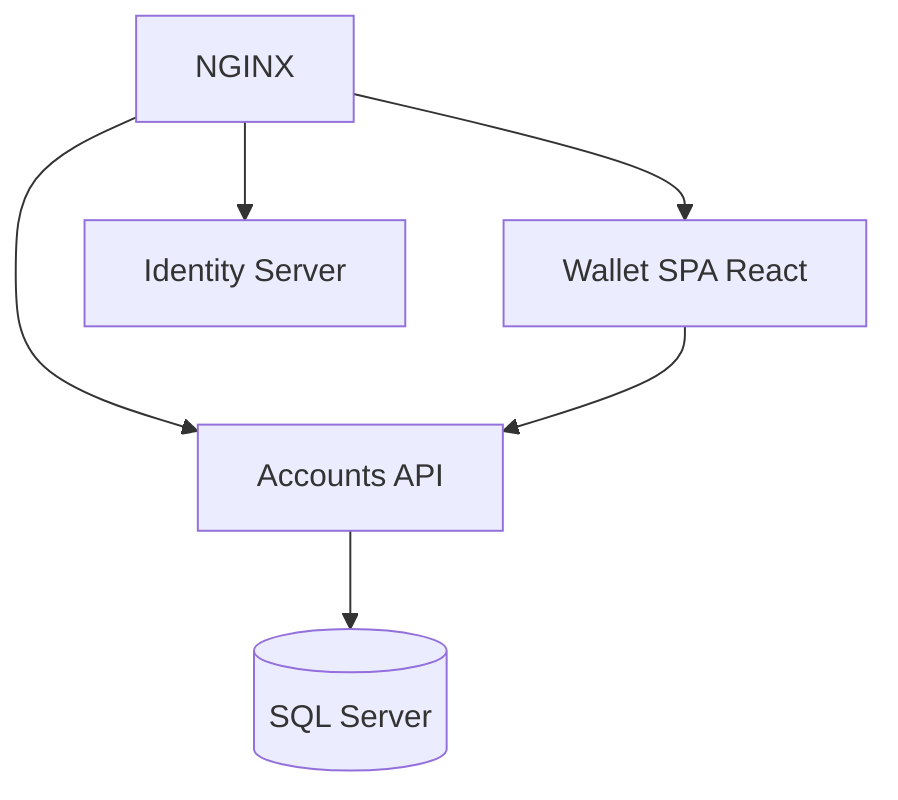

# ivanpaulovich/clean-architecture-manga

> Educational example of Clean Architecture in .NET and React, for learning to design modular applications.

## The problem
Clean architecture principles stay abstract without a complete project that applies them and runs.

## What it actually does
Implements a virtual wallet (sign-up, deposit, withdrawal, transfer) in .NET with a React client. The README describes the use cases, hexagonal, onion and clean architecture, design patterns, DDD, TDD, SOLID, EF Core and Docker. Everything starts with a script in `.docker`.

## How it is wired
Simplified diagram based on the write-up, no diagram provided.



## Trying it
```bash
cd .docker && ./setup.sh
```
On Windows: `cd .docker && ./setup.ps1`.

## Cost and gotchas
Free. Requires Docker and accepting a self-signed certificate at `https://wallet.local:8081`. The README mentions .NET 6, 5 and Core 3.1, which are old versions.

## What it is not
It is not a production-ready starter template nor a framework: it is a learning example.

## Alternatives
No alternative named in the README.

## For you
Ignore: a .NET architecture learning resource, with no direct link to a data / AI / MLOps profile.
