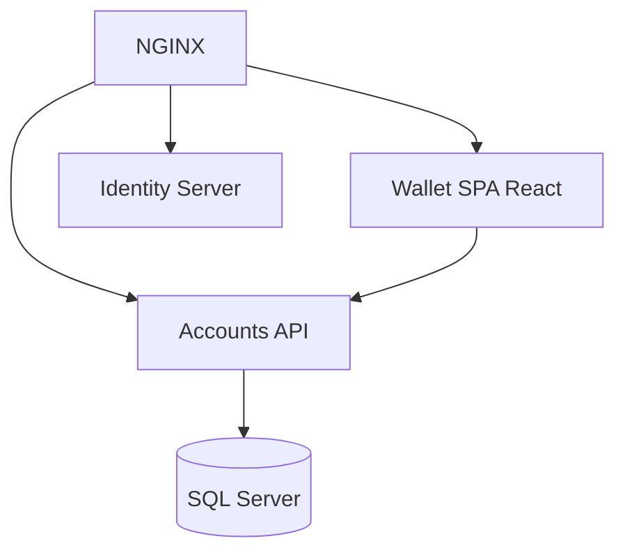

# ivanpaulovich/clean-architecture-manga

> Exemple pédagogique de Clean Architecture en .NET et React, pour apprendre à concevoir des applications modulaires.

## Le problème
Les principes d'architecture propre restent abstraits sans projet complet qui les applique et se lance.

## Ce que ça fait vraiment
Implémente un portefeuille virtuel (inscription, dépôt, retrait, transfert) en .NET avec un client React. Le README décrit les cas d'usage, l'architecture hexagonale, oignon et propre, des patrons de conception, DDD, TDD, SOLID, EF Core et Docker. L'ensemble démarre avec un script dans `.docker`.

## Comment c'est branché
Schéma simplifié d'après la fiche, sans diagramme fourni.



## Essayer
```bash
cd .docker && ./setup.sh
```
Sous Windows : `cd .docker && ./setup.ps1`.

## Coût et pièges
Gratuit. Il faut Docker et accepter un certificat auto-signé sur `https://wallet.local:8081`. Le README cite .NET 6, 5 et Core 3.1, versions anciennes.

## Ce que ce n'est pas
Ce n'est pas un modèle de démarrage prêt pour la production ni un framework : c'est un exemple d'apprentissage.

## Alternatives
Aucune alternative nommée dans le README.

## Pour toi
Ignorer : support d'apprentissage d'architecture .NET, sans lien direct avec un profil data / IA / MLOps.

