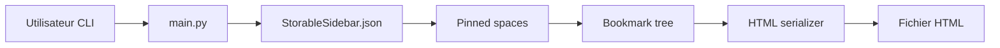

# ivnvxd/arc-export

> Python script that exports Arc Browser's pinned tabs to an HTML bookmarks file.

## The problem
Arc offers no export of pinned tabs, which blocks switching to another browser.

## What it actually does
Reads Arc's `StorableSidebar.json` (or the one in the project folder), converts it into a bookmark tree per pinned space, then writes a timestamped HTML file importable into any browser. Everything lives in `main.py`.

## How it is wired


## Trying it
```bash
curl -o main.py https://raw.githubusercontent.com/ivnvxd/arc-export/main/main.py
python3 main.py -v -o my_bookmarks.html
```

## Cost and gotchas
Free. Depends on the internal format of Arc's file, which may change; last push February 2025.

## What it is not
Only exports pinned tabs, not history or passwords.

## Alternatives
No alternative cited in the README.

## For you
Ignore: a browser migration utility unrelated to data or AI, and barely active.
