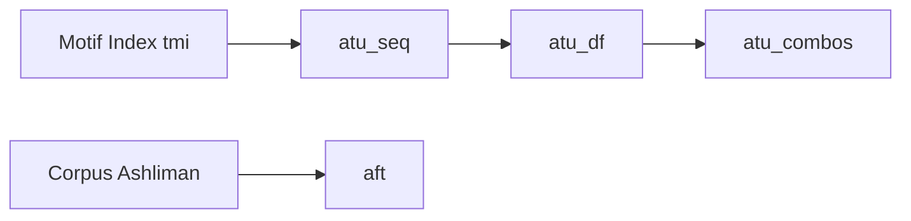

# j-hagedorn/trilogy

> Clean datasets of tale motifs and types (Thompson, ATU) for natural language processing.

## The problem
Catalogs of myths and folklore exist mostly in unstructured form, hard to use in NLP.

## What it actually does
In `/data`: `tmi` (Thompson Motif Index, one motif per line), `atu_df`, `atu_seq` and `atu_combos` (tale types, motifs and co-occurrences), `aft` (tales annotated with their ATU type, usable as training data). A data dictionary and a getting-started guide are mentioned.

## How it is wired
Simplified diagram based on the sheet, no diagram provided.


## Trying it
```bash
# Aucune commande documentée : voir le document Getting Started du dépôt.
```

## Cost and gotchas
The README claims CC-BY-SA 4.0 (share-alike) but GitHub does not recognize the license. Last push in May 2025. Citing the sources is mandatory.

## What it is not
Not a model or a classifier: only data. The annotated corpus comes from a single collection.

## Alternatives
None named in the README.

## For you
Worth watching: a niche dataset for text or motif classification, to be checked for licensing before any use.
