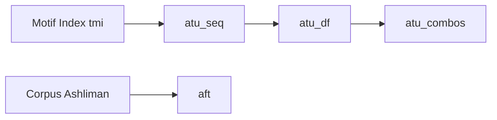

# j-hagedorn/trilogy

> Jeux de données propres sur les motifs et types de contes (Thompson, ATU) pour le traitement du langage.

## Le problème
Les catalogues de mythes et de folklore existent surtout en forme non structurée, difficile à exploiter en NLP.

## Ce que ça fait vraiment
Dans `/data` : `tmi` (Thompson Motif Index, un motif par ligne), `atu_df`, `atu_seq` et `atu_combos` (types de contes, motifs et co-occurrences), `aft` (contes annotés avec leur type ATU, utilisables comme données d'entraînement). Un dictionnaire de données et un guide de démarrage sont mentionnés.

## Comment c'est branché
Schéma simplifié d'après la fiche, sans diagramme fourni.


## Essayer
```bash
# Aucune commande documentée : voir le document Getting Started du dépôt.
```

## Coût et pièges
Le README annonce CC-BY-SA 4.0 (partage à l'identique) mais GitHub ne reconnaît pas la licence. Dernier push en mai 2025. Citation obligatoire des sources.

## Ce que ce n'est pas
Pas un modèle ni un classifieur : seulement des données. Le corpus annoté vient d'un seul recueil.

## Alternatives
Aucune nommée dans le README.

## Pour toi
À surveiller : jeu de données de niche pour de la classification de textes ou de motifs, à vérifier côté licence avant tout usage.

