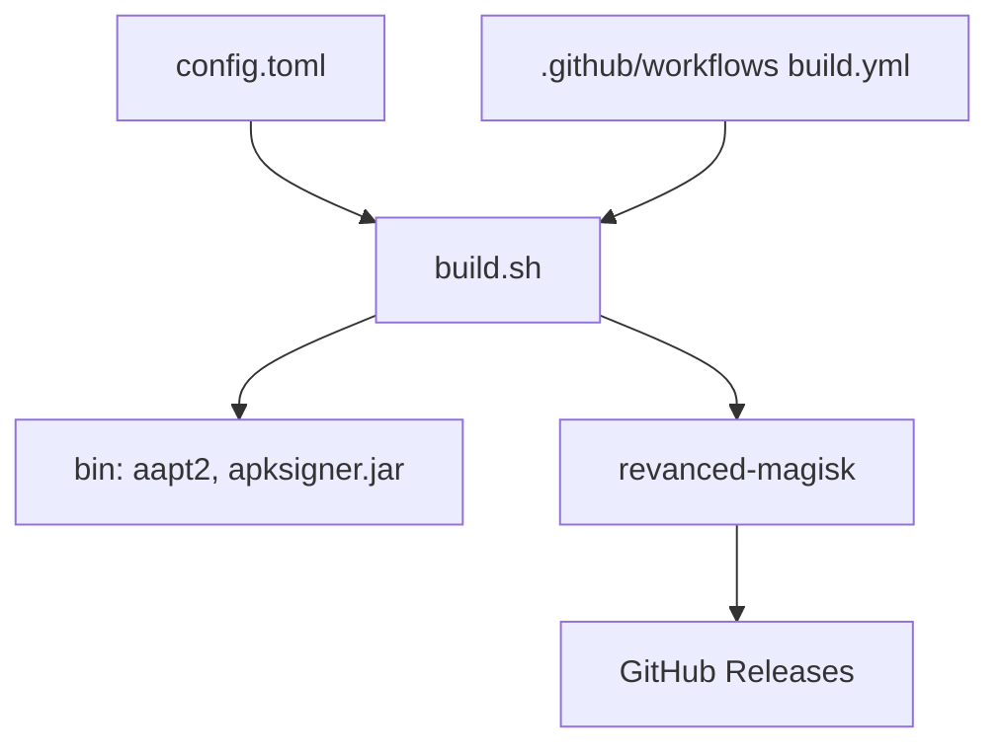

# j-hc/revanced-magisk-module

> Builder of Magisk modules and non-root APKs from ReVanced patches.

## The problem
Applying ReVanced patches by hand to Android apps and keeping them up to date is tedious.

## What it actually does
A `config.toml` chooses the apps and patches. `build.sh` (Linux) or `build-termux.sh` (Termux) produce Magisk modules and APKs, size-optimized, using the tools in the `bin` folder. A GitHub Actions workflow publishes the results to releases, updated daily. The modules manage the original app's version and avoid root detection.

## How it is wired


## Trying it
```bash
git clone https://github.com/j-hc/revanced-magisk-module --depth 1
cd revanced-magisk-module
./build.sh
bash <(curl -sSf https://raw.githubusercontent.com/j-hc/revanced-magisk-module/main/build-termux.sh)
```

## Cost and gotchas
Free. Requires a device rooted with Magisk or KernelSU for the modules. The README does not detail the build prerequisites.

## What it is not
Not a general Android development tool. It modifies third-party apps, which may breach their terms of use; the README does not address this.

## Alternatives
rvmm-zygisk-mount: alternative mounting if the classic mounting fails. rvmm-config-gen: generates the configuration.

## For you
Ignore: mobile app modification, outside the data, AI or MLOps scope.
