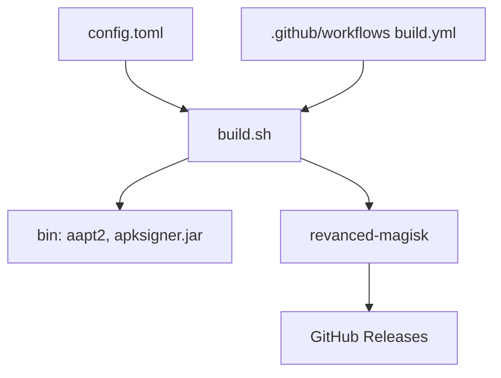

# j-hc/revanced-magisk-module

> Constructeur de modules Magisk et d'APK non-root à partir des patches ReVanced.

## Le problème
Appliquer à la main les patches ReVanced aux applications Android et les maintenir à jour est fastidieux.

## Ce que ça fait vraiment
Un `config.toml` choisit les applications et les patches. `build.sh` (Linux) ou `build-termux.sh` (Termux) produisent modules Magisk et APK, optimisés en taille, via les outils du dossier `bin`. Un workflow GitHub Actions publie les résultats dans les releases, mis à jour chaque jour. Les modules gèrent la version de l'application d'origine et évitent la détection root.

## Comment c'est branché


## Essayer
```bash
git clone https://github.com/j-hc/revanced-magisk-module --depth 1
cd revanced-magisk-module
./build.sh
bash <(curl -sSf https://raw.githubusercontent.com/j-hc/revanced-magisk-module/main/build-termux.sh)
```

## Coût et pièges
Gratuit. Nécessite un appareil rooté avec Magisk ou KernelSU pour les modules. Le README ne détaille pas les prérequis de build.

## Ce que ce n'est pas
Pas un outil de développement Android général. Il modifie des applications tierces, ce qui peut enfreindre leurs conditions d'usage ; le README n'aborde pas ce point.

## Alternatives
rvmm-zygisk-mount : montage alternatif si le montage classique échoue. rvmm-config-gen : génère la configuration.

## Pour toi
À ignorer : modification d'applications mobiles, hors du périmètre data, IA ou MLOps.

