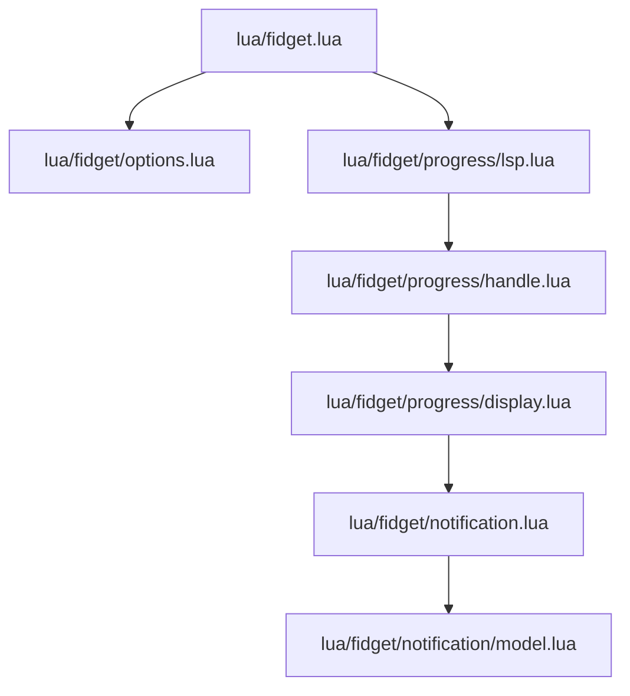

# j-hui/fidget.nvim

> Neovim plugin that discreetly displays notifications and LSP server progress.

## The problem
LSP progress messages and notifications pile up in the status line or disrupt the screen.

## What it actually does
Listens to `$/progress` messages, converts them into notifications managed by a model, and draws them in a small floating window in a screen corner. Can replace `vim.notify()`, offers a history, ASCII spinners and a Telescope extension.

## How it is wired


## Trying it
```lua
{
  "j-hui/fidget.nvim",
  opts = {},
}
```

## Cost and gotchas
Free. Neovim 0.11.3 required. The main branch may have breaking changes: pin a version.

## What it is not
Not an LSP client. Without a configured LSP server, it displays no progress.

## Alternatives
rcarriga/nvim-notify, vigoux/notifier.nvim and nvim-lua/lsp-status.nvim.

## For you
Ignore: Neovim editor comfort, with no direct link to data / AI work.
