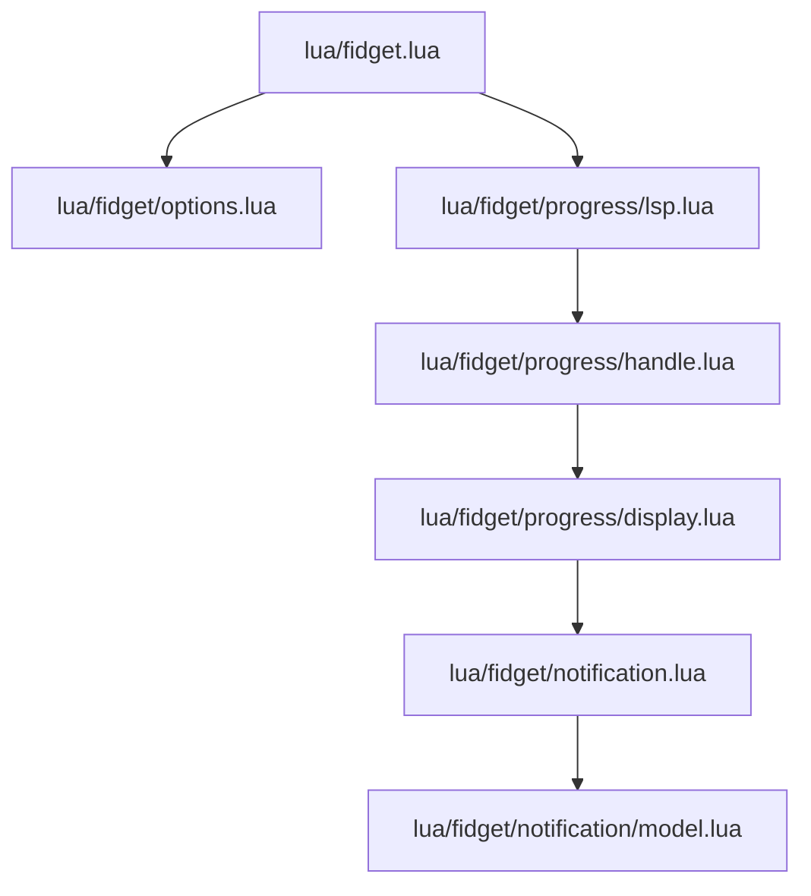

# j-hui/fidget.nvim

> Plugin Neovim qui affiche discrètement les notifications et la progression des serveurs LSP.

## Le problème
Les messages de progression LSP et les notifications s'entassent dans la ligne de statut ou perturbent l'écran.

## Ce que ça fait vraiment
Écoute les messages `$/progress`, les convertit en notifications gérées par un modèle, et les dessine dans une petite fenêtre flottante en coin d'écran. Peut remplacer `vim.notify()`, offre un historique, des spinners ASCII et une extension Telescope.

## Comment c'est branché


## Essayer
```lua
{
  "j-hui/fidget.nvim",
  opts = {},
}
```

## Coût et pièges
Gratuit. Neovim 0.11.3 requis. Branche principale susceptible de changements cassants : épingler une version.

## Ce que ce n'est pas
Pas un client LSP. Sans serveur LSP configuré, il n'affiche aucune progression.

## Alternatives
rcarriga/nvim-notify, vigoux/notifier.nvim et nvim-lua/lsp-status.nvim.

## Pour toi
Ignorer : confort d'éditeur Neovim, sans rapport direct avec un travail data / IA.

