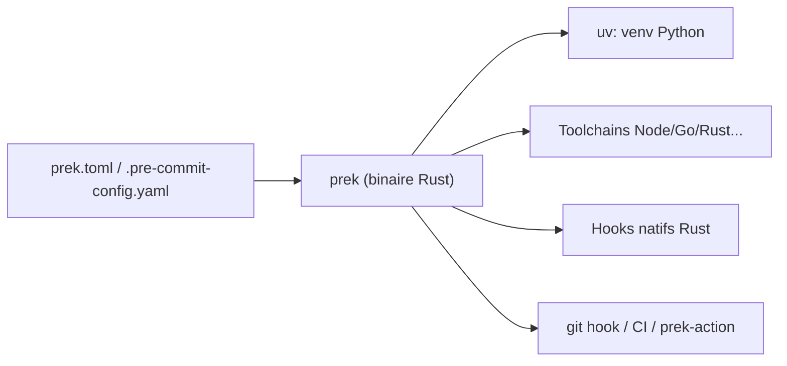

# j178/prek

> Rust rewrite of pre-commit: a single binary, compatible with existing configurations, faster.

## The problem
Pre-commit is slow to install and depends on Python; in CI and in monorepos, this costs time and disk space.

## What it actually does
Runs hooks (format, lint, secret detection) before commit, on demand or in CI. Reads pre-commit YAML configs or a native `prek.toml`. Manages Python environments via `uv`, installs Python, Node, Bun, Go, Rust and Ruby toolchains, and shares environments between hooks. Workspace mode for monorepos, native hooks in Rust, checksum verification and `prek update --cooldown-days`.

## How it is wired


## Trying it
```bash
uv tool install prek
# ou : pip install prek   /   brew install prek
prek run --all-files
prek self update          # si installé via le script officiel
```

## Cost and gotchas
Free. Young project (created in 2024) but already used by CPython, Airflow, FastAPI. The `curl | sh` installer runs a remote script: prefer `uv` or the package manager.

## What it is not
Not a new hook library: it reuses those of pre-commit. Hooks still have to be configured per project.

## Alternatives
- pre-commit: the original tool, which prek replaces without changing the config.

## For you
Adopt: drop-in replacement for pre-commit, faster, built on `uv`, useful in CI for Python data/ML projects.
