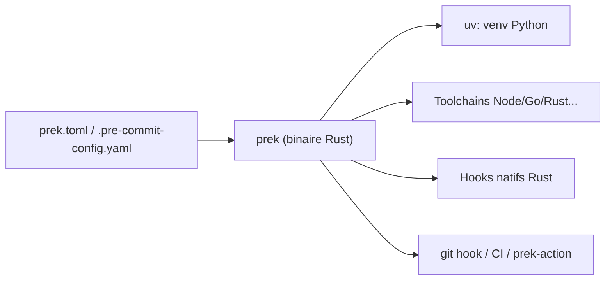

# j178/prek

> Réécriture en Rust de pre-commit : un binaire unique, compatible avec les configurations existantes, plus rapide.

## Le problème
Pre-commit est lent à installer et dépend de Python ; en CI et en monorepo, cela coûte du temps et du disque.

## Ce que ça fait vraiment
Exécute des hooks (format, lint, détection de secrets) avant commit, à la demande ou en CI. Lit les configs pre-commit YAML ou un `prek.toml` natif. Gère les environnements Python via `uv`, installe les chaînes Python, Node, Bun, Go, Rust et Ruby, et partage les environnements entre hooks. Mode workspace pour monorepos, hooks natifs en Rust, vérification des sommes de contrôle et `prek update --cooldown-days`.

## Comment c'est branché


## Essayer
```bash
uv tool install prek
# ou : pip install prek   /   brew install prek
prek run --all-files
prek self update          # si installé via le script officiel
```

## Coût et pièges
Gratuit. Projet jeune (créé en 2024) mais déjà utilisé par CPython, Airflow, FastAPI. L'installeur `curl | sh` exécute un script distant : préférer `uv` ou le gestionnaire de paquets.

## Ce que ce n'est pas
Pas une nouvelle bibliothèque de hooks : il réutilise ceux de pre-commit. Les hooks restent à configurer par projet.

## Alternatives
- pre-commit : l'outil d'origine, que prek remplace sans changer la config.

## Pour toi
Adopter : remplacement direct de pre-commit, plus rapide, s'appuie sur `uv`, utile en CI de projets Python data/ML.

