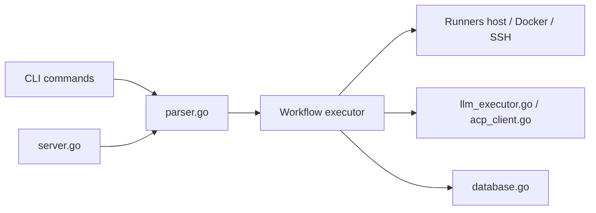

# j3ssie/osmedeus

> YAML workflow orchestration engine for automating security tasks, intended for authorized teams.

## The problem
Security tasks (reconnaissance, scans, triage) are chained in ad hoc scripts that are hard to review, distribute and replay.

## What it actually does
- Declarative YAML workflows (modules and flows) with hooks, conditional branches and module exclusion; execution on the host, in Docker or over SSH.
- Distributed execution through a Redis master/worker queue, scheduling (cron, file watching, events) and more than 80 utility functions.
- LLM steps and agents (including ACP agents such as Claude Code, Codex, Gemini), and cloud provisioning (DigitalOcean, AWS, GCP, Linode, Azure).
- REST API and built-in dashboard; results stored in a database for querying (`osmedeus query vulns`).

## How it is wired


## Trying it
```bash
curl -sSL http://www.osmedeus.org/install.sh | bash
npm install -g @j3ssie/osmedeus
osmedeus run -m recon -t example.com --dry-run
osmedeus workflow list
osmedeus serve
```

## Cost and gotchas
Free; LLM API keys and cloud are at your expense. The README warns that the tool deliberately executes arbitrary code coming from workflows: review any third-party YAML before running it.

## What it is not
It is not a turnkey scanner: it is an orchestrator that relies on other tools. Run it only on targets you own or for which you have testing authorization.

## Alternatives
No alternative named in the README.

## For you
Watch: distributed YAML orchestration with LLM agents is instructive for an MLOps profile, but offensive security use is relevant only within an authorized framework.
