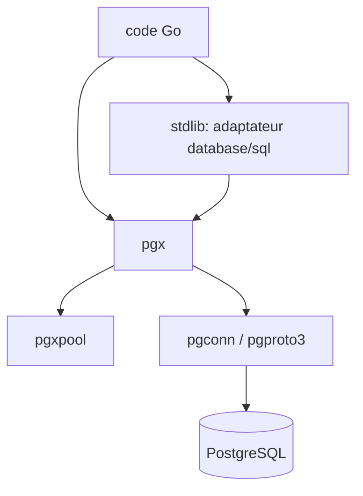

# jackc/pgx

> Pure Go PostgreSQL driver and toolkit, for Go developers targeting PostgreSQL.

## The problem
Go's `database/sql` interface hides PostgreSQL-specific features.
No `LISTEN`/`NOTIFY`, no `COPY`, no binary format for custom types.

## What it actually does
pgx is a low-level interface that exposes PostgreSQL-specific features, with a
`database/sql` adapter for compatibility. It handles ~70 PostgreSQL types, automatic statement
preparation and caching, batch queries, single-round-trip mode, full TLS control,
`COPY`, `json`/`jsonb`, `hstore`, large objects, and nested transactions
simulated with savepoints. The underlying packages (wire protocol, type mapping) are used to
write other drivers, proxies or logical replication clients.

## How it is wired


## Trying it
```bash
go get github.com/jackc/pgx/v5
```

## Cost and gotchas
Free. A PostgreSQL instance is needed. Local development spins up PostgreSQL clusters
14-18 and a CockroachDB node per checkout, via `scripts/setup-host`, `mise` and `./test.sh` — heavy
if you just want to contribute; CONTRIBUTING.md describes how to test against an existing server.

## What it is not
It is not an ORM or a mapper: the README recommends `scany`, `ksql`, `pmx` or `stephenafamo/scan`
for scanning into structs. It is not useful if you target several DBMSs or if another
library forces `database/sql` on you.

## Alternatives
- `github.com/vingarcia/ksql`: SQL client designed to make SQL more productive in Go.
- `github.com/pashagolub/pgxmock`: mock pgx in tests without a real database.
- `github.com/jackc/tern`: standalone SQL migration system, if migration is what interests you.

## For you
The default choice whenever a Go service in your data stack talks to PostgreSQL and you want `COPY`
for bulk loads.
