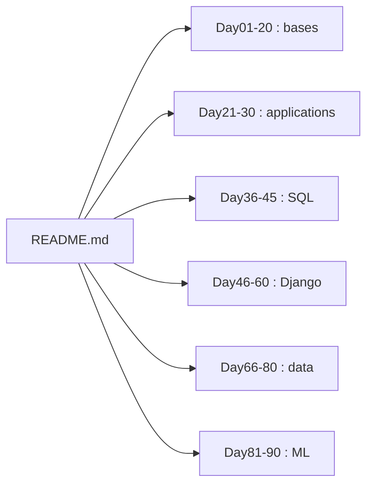

# jackfrued/Python-100-Days

> Chinese-language 100-day Python course, from the basics to Django, data analysis and machine learning.

## The problem
A beginner who wants to learn Python end to end struggles to find a coherent plan, from the language through to deployment and data science.

## What it actually does
A day-by-day plan: Day01–20 basics (variables, structures, functions, OOP), Day21–30 files, CSV, Excel, PDF, images, regex, Day36–45 databases and SQL, Day46–60 Django, Day61–65 web scraping, Day66–80 NumPy, pandas and visualization, Day81–90 machine learning, Day91–99 team project. The content is in Chinese. The README also mentions a paid offer (a mutual-help group on WeChat) and Zhihu columns.

## How it is wired


## Trying it
Commands present in the README (day 91, Django project):
```bash
python manage.py makemigrations app
python manage.py migrate
python manage.py inspectdb > app/models.py
```

## Cost and gotchas
Free to read; a paid follow-up group is offered by the author. The architecture graph describes a pipeline (Hexo, CI, CDN) that the graph itself says it assumes for lack of build files: not retained here. No license declared, so no right of reuse.

## What it is not
Neither a library nor a specialized data/AI path: the ML part is a 10-day introduction. The repository is not a published site.

## Alternatives
No alternative named in the README.

## For you
Ignore: general-purpose course in Chinese, unlicensed, with an introductory data/ML section; better to use an up-to-date ML resource in French or English.
