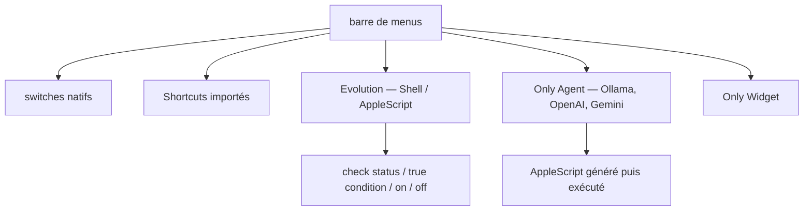

# jacklandrin/OnlySwitch

> macOS menu bar application bundling about fifty system switches.

## The problem
Hiding desktop icons, switching to dark mode, muting the microphone or hiding the notch each require a buried setting or a dedicated app.
Multiplying small menubar apps is precisely what clutters the menu bar.

## What it actually does
A list of native switches — dark mode, Night Shift, Bluetooth, Keep awake, Xcode cache, empty the trash, Pomodoro timer, radio — that can be toggled from the keyboard in the bar.
"Evolution" lets you create your own switches in Shell or AppleScript, with a state-check script, a true condition, turn-on and turn-off, all testable before saving.
macOS Shortcuts can be imported, and since 2.5.0 all of this can also be placed as Apple widgets.
"Only Agent" generates an AppleScript from a request in English via Ollama, OpenAI or Gemini, and runs it immediately if agent mode is active.

## How it is wired


## Trying it
```bash
brew install only-switch
```

## Cost and gotchas
Free. "Low Power Mode" goes through root commands and asks for the password again on each toggle; Only Agent requires macOS 26.0+ and an OpenAI or Gemini key if you do not use Ollama.
On macOS 27, icon hiding relies on a private API, incompatible with the Mac App Store and breakable by a system update.

## What it is not
It is not cross-platform: macOS only. It is not stable everywhere — "Hide notch", "Hide Windows" and "Top Sticker" are marked as partially finished or problematic.
The AI agent is not an assistant: it builds an AppleScript and runs it, with no safeguard described.

## Alternatives
- Hidden: cited as the origin of the idea of hiding icons, if that is your only need.
- Dozer: mentioned alongside Hidden for the same function.
- SpotMenu: reference cited for Spotify / Apple Music control alone.

## For you
Outside the data/AI scope: a macOS workstation convenience, with an AppleScript agent that executes without a safety net.
