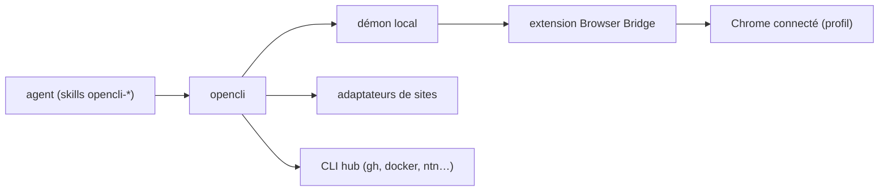

# jackwener/OpenCLI

> Turns websites into deterministic CLI commands that an agent can drive.

## The problem
Scraping a logged-in site means handling cookies, sessions and anti-bot measures for every page.
An agent that "clicks" through screenshots is slow, expensive and not reproducible.

## What it actually does
Built-in adapters expose 100+ sites (Reddit, HackerNews, Twitter, LinkedIn, Bilibili…) as subcommands.
A Chrome extension (Browser Bridge) plus a local daemon drive your already logged-in Chrome.
`opencli browser` provides the raw primitives: `open`, `state`, `click`, `type`, `extract`, `network`, `eval`…
Six installable skills give these primitives to Claude Code or Cursor; it also serves as a hub for `gh`, `docker`, `tg`, Notion.

## How it is wired


## Trying it
```bash
npm install -g @jackwener/opencli
opencli doctor
opencli list
opencli hackernews top --limit 5
npx skills add jackwener/opencli
opencli bilibili hot -f json
```

## Cost and gotchas
Node ≥ 20.18.1; the extension is installed from the Chrome Web Store or in developer mode.
The agent acts with **your** logged-in session: publishing, following, sending messages are available commands.

## What it is not
Not an official API of the covered sites: adapters break when the site changes (hence the `opencli-autofix` skill).
Not free of account risk: automating LinkedIn, Xiaohongshu or Twitter with your credentials makes the user responsible.
The README declares no license and the project relies on a single maintainer.

## Alternatives
No alternative named in the README; only community plugins (github-trending, juejin, vk).

## For you
A useful curiosity to automate monitoring of sites without APIs — keep it confined to a dedicated Chrome profile.
