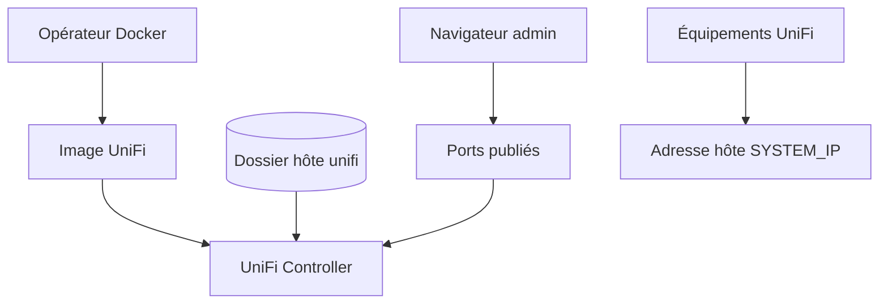

# jacobalberty/unifi-docker

> Docker image of the Unifi network controller, for anyone administering Ubiquiti equipment.

## The problem
Installing and updating the Unifi controller, Java and the OS by hand is a pain.

## What it actually does
Packages the Unifi controller in a container, without implementing its logic. Data stays in a host volume `~/unifi` (data, log, cert). Requires publishing ports 8080, 8443, 3478/udp and 10001/udp and setting `SYSTEM_IP` so that devices can find the controller. Multi-architecture images (amd64, armhf, arm64).

## How it is wired


## Trying it
```bash
mkdir -p unifi/data
mkdir -p unifi/log
docker run -d --init \
   --restart=unless-stopped \
   -p 8080:8080 -p 8443:8443 -p 3478:3478/udp -p 10001:10001/udp \
   -e SYSTEM_IP='<your docker host ip>' \
   -e TZ='Africa/Johannesburg' \
   -v ~/unifi:/unifi \
   --user unifi \
   --name unifi \
   jacobalberty/unifi
```

## Cost and gotchas
Free but requires Ubiquiti hardware. Back up before every update. Self-signed certificate on first access. No health check inferred (code not provided).

## What it is not
Not a reimplementation of the controller: simply a packaging of Ubiquiti's. The README stays focused on that product.

## Alternatives
No alternative named in the README.

## For you
Ignore: only useful if you administer a Unifi network, unrelated to data or MLOps.
