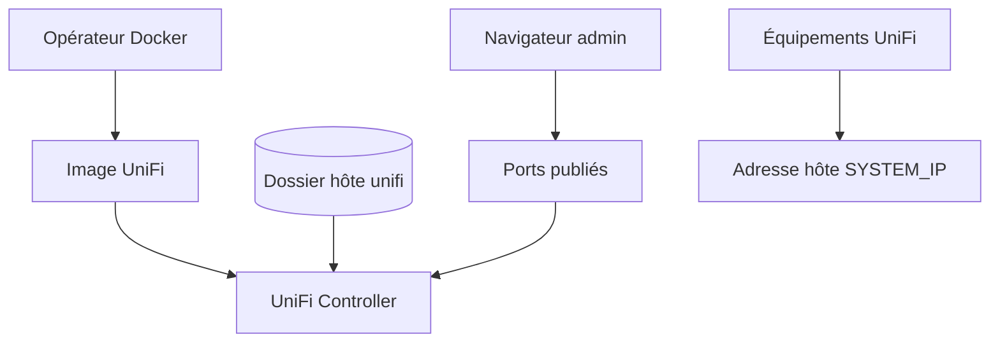

# jacobalberty/unifi-docker

> Image Docker du contrôleur réseau Unifi, pour qui administre des équipements Ubiquiti.

## Le problème
Installer et mettre à jour le contrôleur Unifi, Java et l'OS à la main est pénible.

## Ce que ça fait vraiment
Empaquette le contrôleur Unifi dans un conteneur, sans implémenter sa logique. Les données restent dans un volume hôte `~/unifi` (data, log, cert). Exige de publier les ports 8080, 8443, 3478/udp et 10001/udp et de régler `SYSTEM_IP` pour que les équipements trouvent le contrôleur. Images multi-architecture (amd64, armhf, arm64).

## Comment c'est branché


## Essayer
```bash
mkdir -p unifi/data
mkdir -p unifi/log
docker run -d --init \
   --restart=unless-stopped \
   -p 8080:8080 -p 8443:8443 -p 3478:3478/udp -p 10001:10001/udp \
   -e SYSTEM_IP='<your docker host ip>' \
   -e TZ='Africa/Johannesburg' \
   -v ~/unifi:/unifi \
   --user unifi \
   --name unifi \
   jacobalberty/unifi
```

## Coût et pièges
Gratuit mais exige du matériel Ubiquiti. Sauvegarder avant chaque mise à jour. Certificat auto-signé au premier accès. Pas de test de santé inféré (code non fourni).

## Ce que ce n'est pas
Pas une réimplémentation du contrôleur : simple empaquetage de celui d'Ubiquiti. Le README reste centré sur ce produit.

## Alternatives
Aucune alternative nommée dans le README.

## Pour toi
À ignorer : utile seulement si tu administres un réseau Unifi, sans lien avec la data ou le MLOps.

