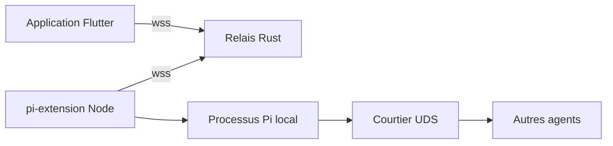

# jacobaraujo7/remote_pi

> Drive your Pi coding agent from your phone, paired by QR code, even when you are away from home.

## The problem
The coding agent runs on your workstation; as soon as you move away from it, you can no longer answer its questions or restart it.

## What it actually does
A Pi extension exposes `/remote-pi` and displays a QR code. The Flutter app pairs with it and chats through a WebSocket relay written in Rust. Locally, a Unix socket broker lets several agents talk to each other (`list_peers`, `agent_send`).

## How it is wired


## Trying it
```bash
pi install npm:remote-pi
/remote-pi
pi install npm:@eko24ive/pi-ask
```

## Cost and gotchas
The free community relay sees the content of messages: the README recommends running your own relay (one Docker command). Traffic is encrypted in transit but not end to end.

## What it is not
Not an agent: you must already use Pi. No end-to-end encryption. The stated status is "working MVP".

## Alternatives
No alternative named in the README.

## For you
Worth watching: useful only if you use Pi, and the public relay exposes your exchanges with the agent.
