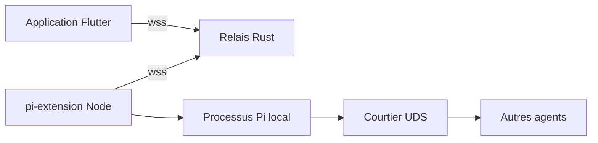

# jacobaraujo7/remote_pi

> Pilote ton agent de code Pi depuis ton téléphone, appairé par QR code, même hors de chez toi.

## Le problème
L'agent de code tourne sur ton poste ; dès que tu t'en éloignes, tu ne peux plus répondre à ses questions ni le relancer.

## Ce que ça fait vraiment
Une extension Pi expose `/remote-pi` et affiche un QR code. L'application Flutter s'y appaire et converse par un relais WebSocket écrit en Rust. En local, un courtier de sockets Unix permet à plusieurs agents de se parler (`list_peers`, `agent_send`).

## Comment c'est branché


## Essayer
```bash
pi install npm:remote-pi
/remote-pi
pi install npm:@eko24ive/pi-ask
```

## Coût et pièges
Le relais communautaire gratuit voit le contenu des messages : le README recommande son propre relais (une commande Docker). Le trafic est chiffré en transit mais pas de bout en bout.

## Ce que ce n'est pas
Pas un agent : il faut déjà utiliser Pi. Pas de chiffrement de bout en bout. L'état annoncé est « MVP fonctionnel ».

## Alternatives
Aucune alternative nommée dans le README.

## Pour toi
À surveiller : utile seulement si tu utilises Pi, et le relais public expose tes échanges avec l'agent.

