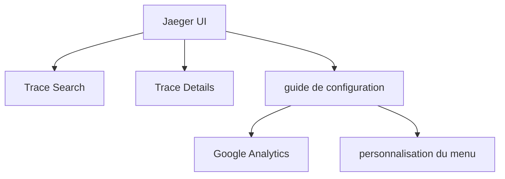

# jaegertracing/jaeger-ui

> Jaeger's web interface for visualizing distributed traces.

## The problem
Not documented: the README does not describe the problem solved.

## What it actually does
The README is three lines long. It mentions two views, trace search and trace detail, and points to a configuration guide.
That guide covers Google Analytics tracking, menu customization and other aspects of the interface's behavior.
Nothing else is documented here: no installation, no dependencies, no API.

## How it is wired

## Trying it
No command documented in this README.

## Cost and gotchas
Not documented. The only point flagged is the possibility of configuring Google Analytics tracking, so check before deploying.

## What it is not
It is not Jaeger: it is only the interface part, which assumes a Jaeger backend is already in place.
The README does not say how to build or deploy it on its own.

## Alternatives
No alternative named in the README.

## For you
Nothing to decide here: if you already use Jaeger, this interface is part of it; otherwise, this README offers nothing.
