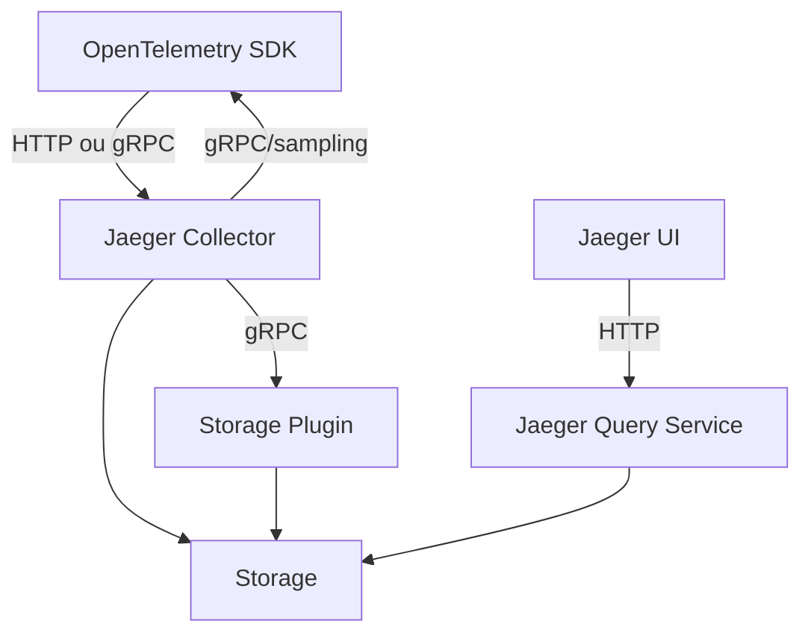

# jaegertracing/jaeger

> Distributed tracing platform, CNCF graduated project, for diagnosing chains of services.

## The problem
When a request crosses eight services, each one's logs do not say where the time was spent
or which one failed first.

## What it actually does
A collector receives traces over OTLP (gRPC on 4317, HTTP on 4318), writes them to a storage backend
(directly or through a gRPC plugin), and returns the sampling configuration to the SDKs. A Query service
reads the storage and feeds the UI on port 16686. The "all-in-one" image bundles UI, collector,
query and in-memory storage. v2 has been released and reuses components of the OpenTelemetry Collector.

## How it is wired


## Trying it
```bash
docker run --rm --name jaeger \
  -p 16686:16686 \
  -p 4317:4317 \
  -p 4318:4318 \
  jaegertracing/jaeger:latest
```

## Cost and gotchas
Free, but the default storage of the all-in-one image is in memory: everything vanishes on shutdown.
A deprecated configuration option gets at least 3 months or two minor versions before
removal; support for the `N-1` minor version of Go is dropped as soon as `N` is released.

## What it is not
Not a metrics or log collector: these are traces. Not instrumentation —
you need OpenTelemetry SDKs in the services. The all-in-one image is not a production
configuration; the README points to the getting-started guide for that.

## Alternatives
- OpenTelemetry Collector: some of whose components Jaeger v2 reuses.

## For you
The tracer to put in place by default in front of a multi-service inference pipeline, before optimizing blindly.
