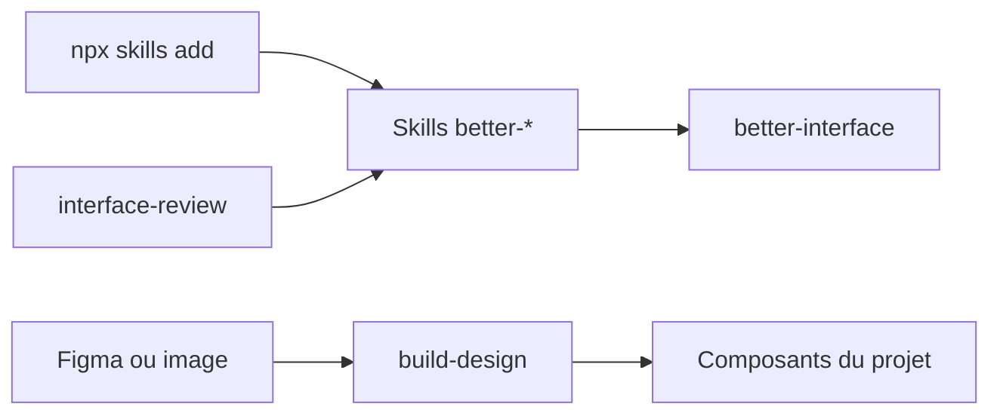

# jakubkrehel/skills

> Agent skills for designing and reviewing interfaces: typography, colors, accessibility, layout, writing.

## The problem
An agent produces interfaces that look correct but are approximate on exact values, accessibility and interface text.

## What it actually does
`better-*` skills (ui, typography, colors, accessibility, layout, writing) bundled by `better-interface`. `interface-review` reviews a branch or a PR. Others: `explain-interface` (how a site is built), `break` and `state-machine` (component tests on a throwaway page), `build-design` (from Figma or an image), `variant`, `technical-drawing`.

## How it is wired


## Trying it
```bash
npx skills add jakubkrehel/skills
/plugin marketplace add jakubkrehel/skills
/plugin install interfaces@interfaces
```

## Cost and gotchas
Free; the agent's tokens are on you. `build-design` assumes a Figma file or an image.

## What it is not
Not a component library: these are instructions for the agent. The repository is young (created in July 2026).

## Alternatives
No alternative named in the README.

## For you
Worth watching: useful only if you deliver interfaces (dashboards, demos); for a pure data profile, the benefit is marginal.
