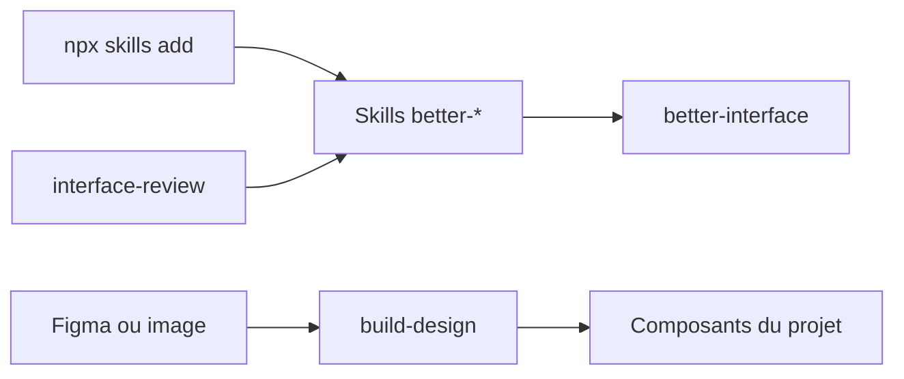

# jakubkrehel/skills

> Skills d'agents pour concevoir et relire des interfaces : typographie, couleurs, accessibilité, mise en page, rédaction.

## Le problème
Un agent produit des interfaces correctes en apparence mais approximatives sur les valeurs exactes, l'accessibilité et le texte d'interface.

## Ce que ça fait vraiment
Des skills `better-*` (ui, typography, colors, accessibility, layout, writing) regroupés par `better-interface`. `interface-review` relit une branche ou une PR. D'autres : `explain-interface` (comment un site est construit), `break` et `state-machine` (tests de composants sur une page jetable), `build-design` (depuis Figma ou une image), `variant`, `technical-drawing`.

## Comment c'est branché


## Essayer
```bash
npx skills add jakubkrehel/skills
/plugin marketplace add jakubkrehel/skills
/plugin install interfaces@interfaces
```

## Coût et pièges
Gratuit ; les jetons de l'agent sont à ta charge. `build-design` suppose un fichier Figma ou une image.

## Ce que ce n'est pas
Pas une bibliothèque de composants : ce sont des consignes à l'agent. Le dépôt est jeune (créé en juillet 2026).

## Alternatives
Aucune alternative nommée dans le README.

## Pour toi
À surveiller : utile seulement si tu livres des interfaces (dashboards, démos) ; pour un profil data pur, l'apport est marginal.

